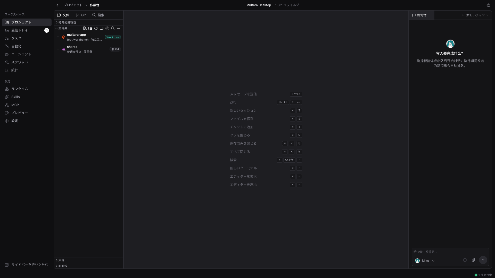
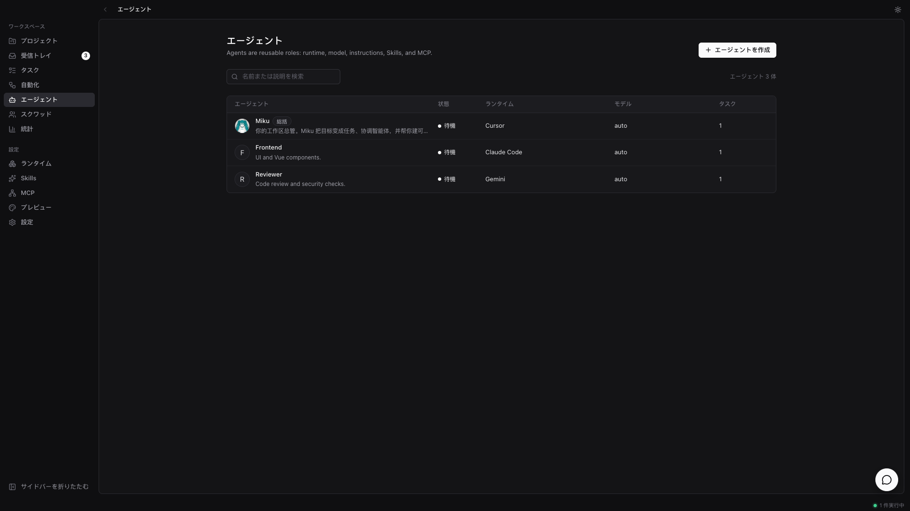
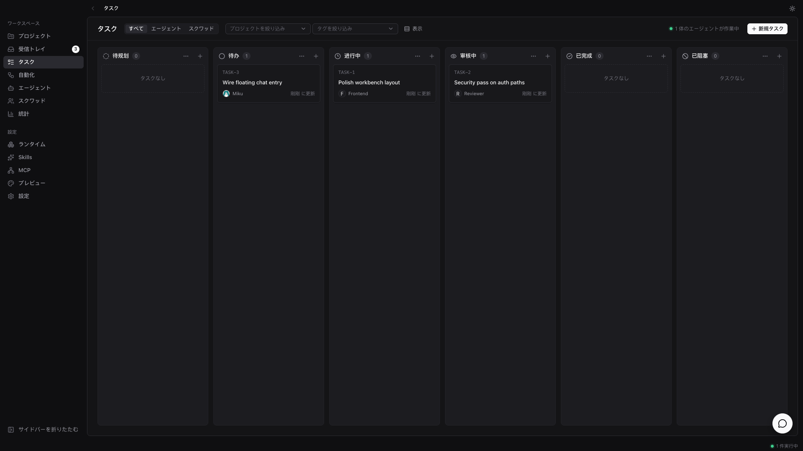
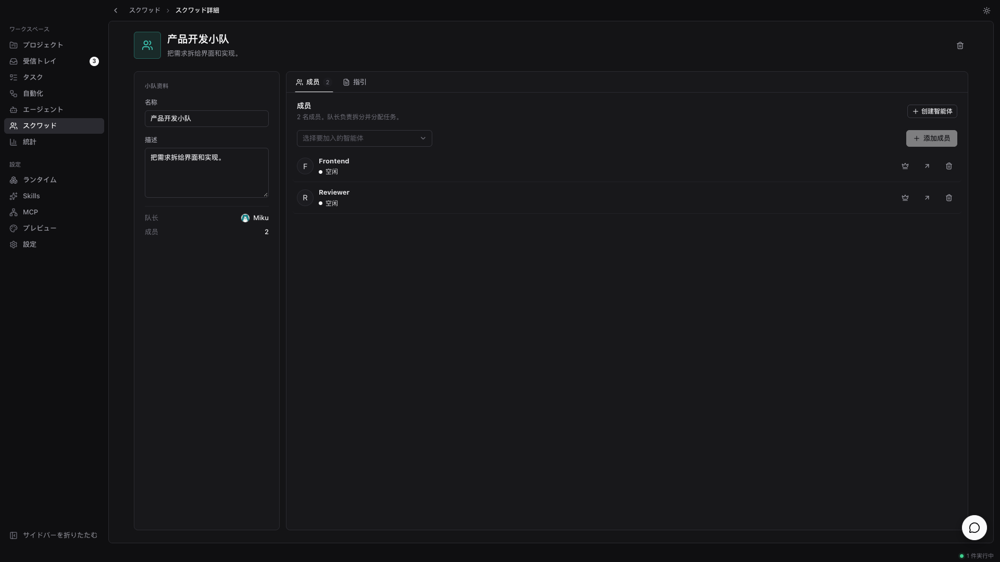
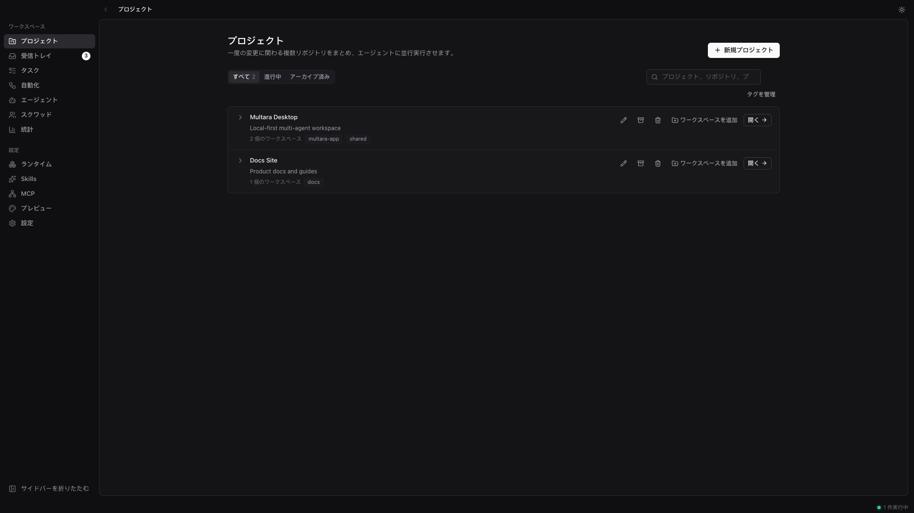
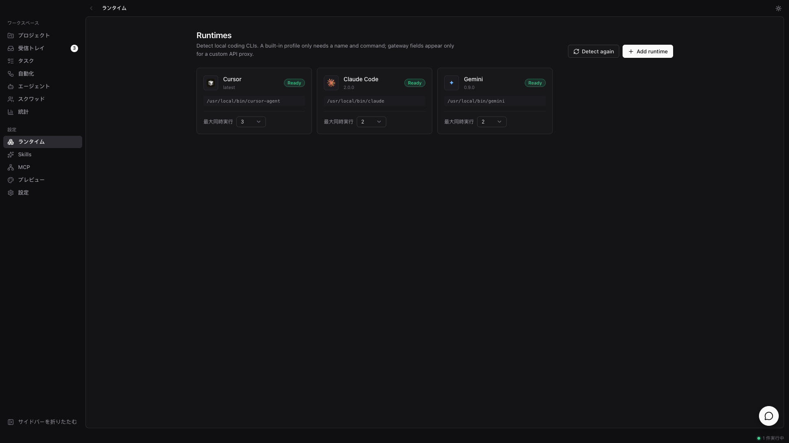
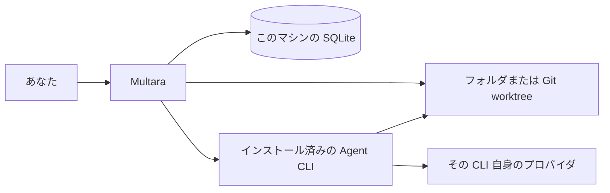

<div align="center">


# Multara

**ローカルファーストの AI コーディングワークベンチ**

すべての AI コーディングエージェントを、ひとつのワークスペースに。

Multara は、複数の AI コーディングエージェントを使う開発者のためのデスクトップアプリです。Claude Code、OpenAI Codex、Cursor Agent、そしてマシン上のほかの CLI が、同じワークスペースを共有します。実在するプロジェクトフォルダ、タスク、Monaco エディタ、Git、そしてエージェントの実行です。

[](https://github.com/tomiaa12/Multara/releases/latest)
[](https://github.com/tomiaa12/Multara/stargazers)


**[English](README.md) · [简体中文](README-zh-CN.md) · [繁體中文](README-zh-TW.md) · 日本語 · [한국어](README-ko.md)**

<p>
  <a href="https://github.com/tomiaa12/Multara/releases/download/v1.14.0/Multara_1.14.0_x64-setup.exe"></a>
  &nbsp;
  <a href="https://github.com/tomiaa12/Multara/releases/download/v1.14.0/Multara_1.14.0_aarch64.dmg"></a>
  &nbsp;
  <a href="https://github.com/tomiaa12/Multara/releases/latest"></a>
</p>

</div>

<p align="center">
  
</p>

<p align="center">
  <sub><em>プロジェクト作業台。ローカルファイル、Monaco エディタ、エージェントチャットが同じウィンドウに並びます。</em></sub>
</p>

---

## 主な機能

### 複数のエージェント、ひとつのワークスペース

エージェントには名前、ランタイム、モデル、指示、そして割り当てた Skills と MCP があります。別々のエージェントが、別々の CLI を同時に使えます。ランタイムごとに同時実行数の上限があります。

プロジェクトの外でも、チャットはフローティングパネルとして残ります。

### タスクとスクワッド

タスクはボードに並びます。エージェントに渡すことも、スクワッドに渡すこともできます。スクワッドを選ぶと、担当はリーダーになります。ボードはエージェント別、スクワッド別に絞り込めます。

スクワッドにはリーダーとほかのメンバーがいます。Multara は先にリーダーを実行し、その実行が終わってからほかのメンバーを開始します。

受信トレイには、プロジェクト、タスク、フローティングチャットの会話が集まります。返答待ちのものもここに入ります。

### ローカルフォルダ、エディタ、Git

プロジェクトは、ひとつの作業に使うフォルダをまとめます。Git リポジトリは現在のブランチで開くか、Git worktree で隔離します。新しいブランチを作るか、既存ブランチを checkout します。Git ではないフォルダは、そのディレクトリのまま開きます。

作業台にはファイルツリー、検索、Monaco エディタ、Git パネル、ターミナル、チャットがあります。Git パネルでは状態の確認、ステージ、コミット、pull、push ができます。

### 実行を見てから、コードを確認する

ツール呼び出し、コマンド、編集はチャットへ流れてきます。計画モードでは、承認するまで先へ進みません。変更されたファイルは Monaco で開けます。エディタに未保存の内容があるとき、Multara はそれを上書きしません。

統計は実行をまとめます。そこには、その実行が記録したトークン数と費用も含まれます。

### つながるもの

- **Skills と MCP。** Multara は、各 CLI がすでに使っている skill ディレクトリと MCP 設定を読み、エージェントへ割り当てます。
- **自動化。** スケジュール、または webhook で、エージェントかスクワッドを実行します。
- **Feishu と Lark。** どちらのチャネルからでも、エージェントまたはスクワッドへメッセージを送れます。返信は Multara に残ります。
- **表示。** ライトとダーク。English、简体中文、繁體中文、日本語、한국어。言語はシステムに従うか、設定で選べます。
- **更新。** アプリは GitHub Releases から自身を更新します。

---

## しくみ

1. プロジェクトにローカルフォルダを追加します。Git リポジトリなら worktree か、現在のディレクトリかを選びます。
2. エージェントを作り、PATH 上で見つかった CLI に結びます。
3. タスクかチャットを、そのエージェントまたはスクワッドに渡します。
4. Multara はワークスペースのディレクトリで CLI を起動します。CLI がディスク上のファイルを編集し、進捗を返します。
5. チャットで実行を読み、Monaco でファイルを開き、コミットするときは Git パネルを使います。

Multara 自身のデータはローカルの SQLite にあります。モデルは同梱せず、エージェント CLI もインストールしません。

## ひとつのウィンドウにする理由

| | 別々のターミナル | Multara |
| --- | --- | --- |
| ファイルを編集する場所 | その CLI を起動したディレクトリ | 追加したフォルダ、または Git worktree |
| 仕事の渡し方 | そのウィンドウのプロンプト | エージェントまたはスクワッド宛てのタスクとチャット |
| あとから見るもの | その CLI の出力 | 流れてくる実行、Monaco、Git パネル |
| 使う CLI | ウィンドウごとにひとつ | インストール済みでサインイン済みの対応 CLI |

すでに入れてある CLI をそのまま使います。Multara は、その外側にあるワークスペースです。

---

## 対応する Agent CLI

Multara は PATH 上でこれらのコマンドを探します。サインインは各 CLI 自身で行います。一覧は [`shared/cli-catalog.json`](shared/cli-catalog.json) と一致しています。

| エージェント | コマンド | エージェント | コマンド |
| --- | --- | --- | --- |
| Claude Code | `claude` | Codex | `codex` |
| Cursor | `cursor-agent` | GitHub Copilot | `copilot` |
| OpenCode | `opencode` | Gemini CLI | `gemini` |
| Qwen Code | `qwen` | Kimi CLI | `kimi` |
| Antigravity | `agy` | CodeArts | `codearts` |
| CodeBuddy | `codebuddy` | DevEco | `deveco` |
| Dim | `dim` | DSH | `dsh` |
| Grok | `grok` | Hermes | `hermes` |
| Kiro | `kiro-cli` | MiniMax Code | `mcode` |
| OMP | `omp` | OpenClaw | `openclaw` |
| Pi | `pi` | Qoder | `qodercli` |
| Qoder CN | `qoderclicn` | QwenPaw | `qwenpaw` |
| Reasonix | `reasonix` | TRAE CLI | `traecli` |
| ZeroClaw | `zeroclaw` | | |

Cursor は `agent` としても検出されます。GitHub Copilot は `github-copilot-cli` としても検出されます。**ランタイム → Add runtime** から、別のローカルコマンドを登録できます。

Claude Code、Codex、OpenCode、Gemini CLI、Qwen Code では、ランタイムに API のベース URL を設定することもできます。

---

## インストール

ボタンのファイルは [Multara v1.14.0](https://github.com/tomiaa12/Multara/releases/tag/v1.14.0) です。より新しいビルドは [リリース一覧](https://github.com/tomiaa12/Multara/releases/latest) にあります。

| プラットフォーム | ダウンロード |
| --- | --- |
| Windows x64 | [NSIS `.exe`](https://github.com/tomiaa12/Multara/releases/download/v1.14.0/Multara_1.14.0_x64-setup.exe) · [MSI、en-US](https://github.com/tomiaa12/Multara/releases/download/v1.14.0/Multara_1.14.0_x64_en-US.msi) · [MSI、zh-CN](https://github.com/tomiaa12/Multara/releases/download/v1.14.0/Multara_1.14.0_x64_zh-CN.msi) |
| macOS Apple Silicon | [`.dmg`](https://github.com/tomiaa12/Multara/releases/download/v1.14.0/Multara_1.14.0_aarch64.dmg) |

`.exe` インストーラーは現在のユーザー向けです。Windows のセットアップは、WebView2 が無いときにそれをダウンロードします。macOS は 10.15 以降です。`Multara.app` を「アプリケーション」へドラッグします。

公開されている macOS ビルドは公証されていません。Gatekeeper がアプリは壊れていると表示したら、隔離属性を外します。

```bash
xattr -cr /Applications/Multara.app
```

macOS Intel と Linux のインストーラーは公開していません。インストール後は、アプリ内から更新できます。

## クイックスタート

1. Multara と、[対応 CLI](#対応する-agent-cli) を少なくともひとつインストールします。ログインはその CLI 自身で完了します。
2. **ランタイム**を開き、**Detect again** を選びます。見つかった CLI は **Ready**、パス、同時実行数の上限を表示します。
3. エージェントを作り、名前を付け、そのランタイムを選びます。初回起動時には Miku というエージェントがすでにあります。
4. プロジェクトを作り、ローカルフォルダを追加します。Git では新しい worktree ブランチが推奨です。既存ブランチを worktree として checkout することも、現在のディレクトリで編集することもできます。
5. エージェントまたはスクワッドのタスクを作るか、プロジェクトを開いてチャットを送ります。
6. 流れてくる実行を見て、エディタと Git パネルでファイルを確認します。

---

## 画面

<p align="center">
  
</p>

<p align="center">
  <sub><em>エージェントはそれぞれ自分のランタイムを持ちます。ここでは Cursor、Claude Code、Gemini です。</em></sub>
</p>

<p align="center">
  
  &nbsp;
  
</p>

<p align="center">
  <sub><em>タスクはボード上で割り当てます。スクワッドにはリーダーとメンバーがいます。</em></sub>
</p>

<p align="center">
  
  &nbsp;
  
</p>

<p align="center">
  <sub><em>プロジェクトはローカルフォルダをまとめます。ランタイムは、このマシンで見つかった CLI です。</em></sub>
</p>

同じインターフェイスのほかの画面: [タスク詳細](screenshots/ja/1920/task-detail.png)、[受信トレイ](screenshots/ja/1920/inbox.png)、[Skills](screenshots/ja/1920/skills.png)、[MCP](screenshots/ja/1920/mcp.png)、[自動化](screenshots/ja/1920/automation.png)、[統計](screenshots/ja/1920/stats.png)、[設定](screenshots/ja/1920/settings.png)。

---

## ローカルファースト

Multara はデスクトップアプリです。シェルは Tauri 2、画面は Vue 3、ローカルの処理は Rust です。プロジェクト、エージェント、スクワッド、チャット、タスク、実行キューは、アプリデータディレクトリの SQLite ファイル `multara.sqlite3` に保存されます。



Multara のアカウントはありません。エージェントの実行は、作業ディレクトリをワークスペースにしたローカルの CLI プロセスです。その CLI は自分のログインを使い、プロンプトを自分のプロバイダへ送ります。

## 対応プラットフォーム

| プラットフォーム | 公開されているインストーラー |
| --- | --- |
| Windows x64 | `.exe` と MSI（`en-US`、`zh-CN`） |
| macOS Apple Silicon | `.dmg`、macOS 10.15 以降 |
| macOS Intel | 未公開 |
| Linux | 未公開 |

## ロードマップ

別のロードマップ文書はありません。進行中の作業は [issues](https://github.com/tomiaa12/Multara/issues) にあり、公開済みビルドは [GitHub Releases](https://github.com/tomiaa12/Multara/releases) に並びます。

## コントリビューション

Issue と pull request を受け付けています。

リリースのワークフローは Node.js 22、pnpm 10、stable Rust を使います。

```bash
git clone https://github.com/tomiaa12/Multara.git
cd Multara
pnpm install
pnpm tauri:dev
```

ローカルフォルダを読み、CLI を起動できるのは `pnpm tauri:dev` です。`pnpm dev` は画面を配信するだけです。`pnpm test` はフロントエンドのユニットテストを実行します。`pnpm build` はフロントエンドの型チェックとウェブバンドルの生成を行います。

## ライセンス

このリポジトリにはライセンスファイルがありません。Copyright © 2026 Multara。
