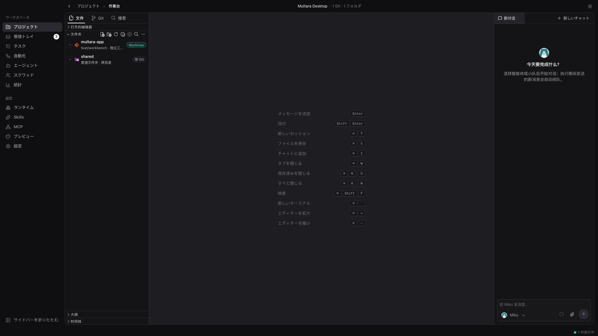
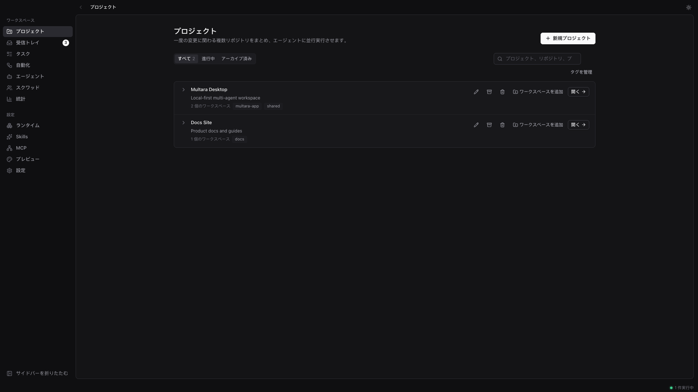
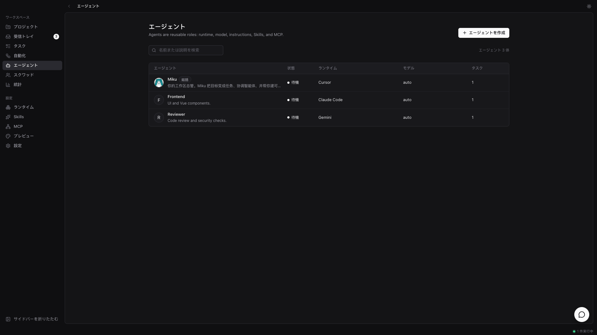
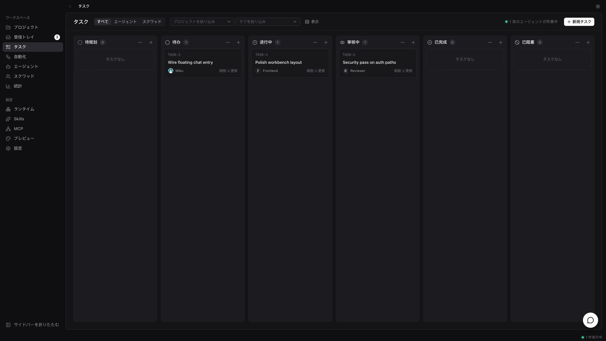
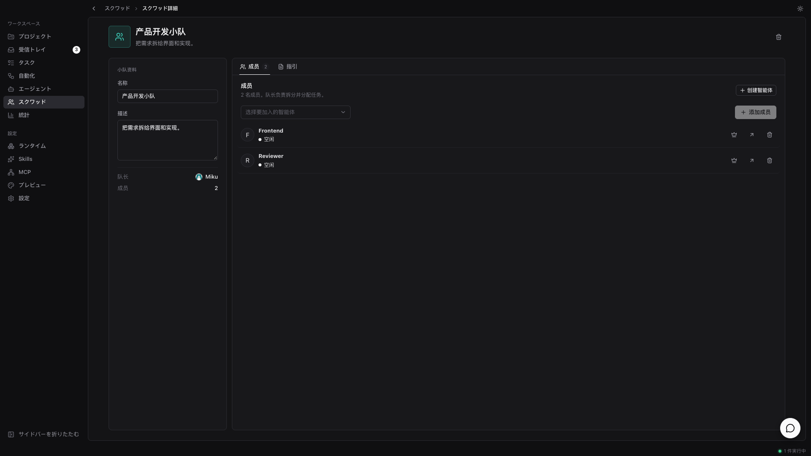

<div align="center">


# Multara

**エージェントは、あなたのマシンで働く。**

Multara はローカル優先のデスクトップワークスペースです。同僚に仕事を振るように AI コーディング
エージェントにタスクを渡し——自分で引き取り、実際のフォルダを編集し、進みを報告し、レビューに
戻します。すでに使っているエージェント CLI に対応。クラウドアカウント不要、ベンダーロックインなし。

[](https://github.com/tomiaa12/Multara/releases)


**[English](README.md) · [简体中文](README-zh-CN.md) · [繁體中文](README-zh-TW.md) · 日本語 · [한국어](README-ko.md)**

</div>

<p align="center">
  
</p>

<p align="center">
  <sub><em>ひとつのローカルワークスペース — プロジェクト、エージェント、レビューが同じウィンドウに。</em></sub>
</p>

<p align="center">
  
  &nbsp;
  
</p>

<p align="center">
  
  &nbsp;
  
</p>

---

## Multara とは

すでに Claude Code、Codex、ほかのエージェントを同時に動かしているはずです。それぞれが別の端末
タブに閉じこもり、セッションが終われば何も覚えておらず、同じ文脈を今日で四回目も説明している。
エージェントを増やすほど、世話をする時間ばかり増えます。

Multara はそれらを一つのローカルワークスペースにまとめます。タスクを渡すとエージェントが自ら
引き取り、あなたが管理するフォルダで動き、進みをストリームし、結果をレビューに戻します。意図、
実行、diff がつながったまま——文脈を組み立て直す必要はなく、あなたが見ない限り確定しません。

---

## チームを組む

*Claude Code、Codex、Cursor、Kimi——一つに絞らない。全部雇う。*

- **すでに使っているエージェント CLI →** Claude Code、Codex、Cursor、Copilot、Kimi、OpenCode、Gemini、Qwen など。
- **エージェントも同僚 →** 名前、プロバイダ、ランタイムを付ければ、ほかのメンバーと同じように並ぶ。
- **小隊 →** エージェントを一つのチームに。リーダーが仕事を振り分ける。
- **Skills →** 一度解いた問題をプレイブックにし、どのエージェントでも再利用。
- **MCP →** エージェントが必要とするツールをつなぐ。
- **あなたのマシンがランタイム →** コードは外に出ない。インストール済み CLI を自動検出。

## 仕事を渡す

*最初はチャットやタスクの数行。最後はディスク上でレビューできる変更。*

- **プロジェクト →** 作業をまとめ、エージェントが使うローカルフォルダを付ける。
- **ワークベンチ →** ファイルツリー、Monaco、Git 状態、チャットを一画面に。
- **ワークスペース分離 →** フォルダを直接開くか、`git worktree` / フォルダコピーで隔離。
- **タスクと自動化 →** チャット外でも作業を追跡。定期ジョブを実行。
- **チャット →** ワークベンチで話すか、ページを離れないフローティングチャット。
- **エージェントまたは小隊を割り当て →** 同僚を選ぶように担当を決める。

## 状況を把握する

*どのエージェントが触った？何を変えた？実行と diff を開く。*

- **ストリーミング実行 →** ツール呼び出し、コマンド、編集をその場で見る。
- **エディタでレビュー →** 変更はディスクに着地。ワークベンチで残す・直す・捨てる。
- **Git パネル →** 同じウィンドウで状態確認、ステージ、コミット。
- **統計 →** エージェントの利用状況を時系列で。
- **必要なときだけ戻る →** 判断が要るときだけ。毎ステップでは呼ばない。

## 自分のものにする

*あなたのマシン、フォルダ、ルール——デフォルトでローカル優先。*

- **ローカル優先 →** プロジェクト、エージェント、小隊、チャット、実行キューは本機の SQLite。
- **ライト / ダークテーマ**
- **English · 简体中文 · 繁體中文 · 日本語 · 한국어** — システム言語に追従、または設定で選択
- **アプリ内更新**（GitHub Releases）

---

## はじめ方

1. **[Multara](https://github.com/tomiaa12/Multara/releases/latest)** を Windows または macOS 向けにダウンロード。
2. [対応エージェント CLI](#ランタイム) を少なくとも一つインストールしてログイン——Multara は駆動するだけで、同梱しません。
3. Multara を開き、ローカルフォルダ付きのプロジェクトを追加し、エージェントを作って仕事を渡す。

| プラットフォーム | インストーラ |
| --- | --- |
| Windows | `.exe` または `.msi` |
| macOS（Apple Silicon） | `.dmg` |
| macOS（Intel） | `.dmg` |

macOS では `Multara.app` を「アプリケーション」にドラッグします。「破損しているため開けません」と出た場合は、ターミナルで次を実行してください：

```bash
xattr -cr /Applications/Multara.app
```

---

## ランタイム

Multara はモデルを同梱しません。すでにインストール・認証済みのエージェント CLI を駆動します——
プロバイダの切り替えはドロップダウンで済み、移行ではありません。

| プロバイダ | CLI | プロバイダ | CLI |
| --- | --- | --- | --- |
| Claude Code | `claude` | OpenAI Codex | `codex` |
| Cursor Agent | `cursor-agent` | GitHub Copilot CLI | `copilot` |
| OpenCode | `opencode` | Gemini | `gemini` |
| Qwen Code | `qwen` | Kimi | `kimi` |
| Grok | `grok` | CodeBuddy | `codebuddy` |
| OpenClaw | `openclaw` | Hermes | `hermes` |
| Pi | `pi` | Antigravity | `agy` |
| Kiro CLI | `kiro-cli` | Qoder CLI | `qodercli` |
| Trae CLI | `traecli` | MiniMax Code | `mcode` |
| …ほか | | | |

---

## インスピレーション

ボード上のエージェント、同僚のように仕事を渡す。Multara はその考えをローカル優先のデスクトップに落とし込みます。
