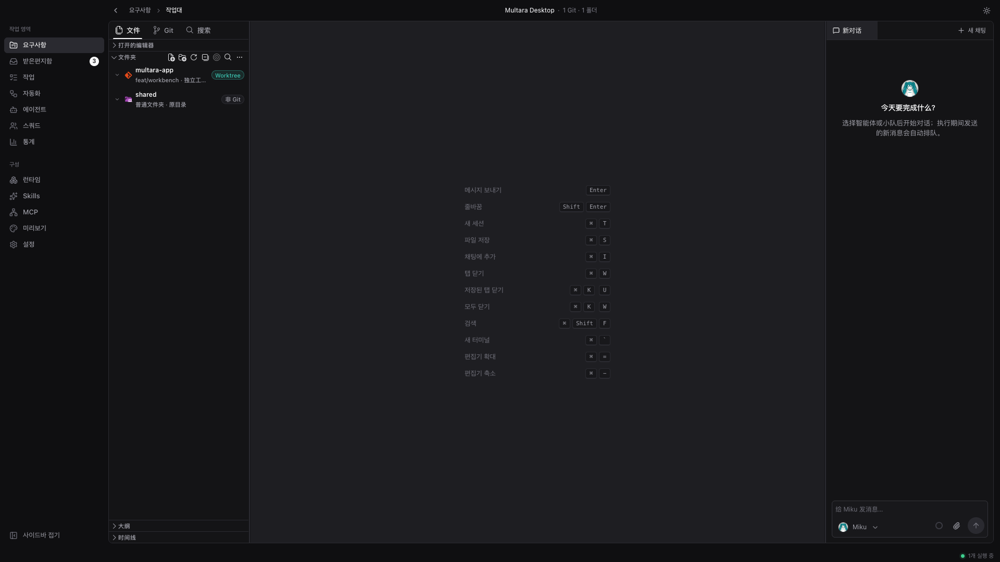
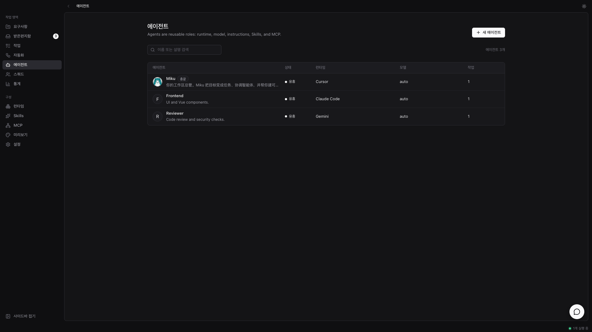
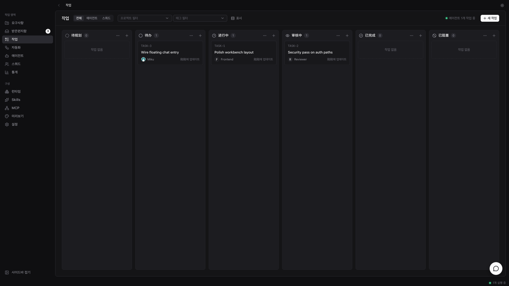
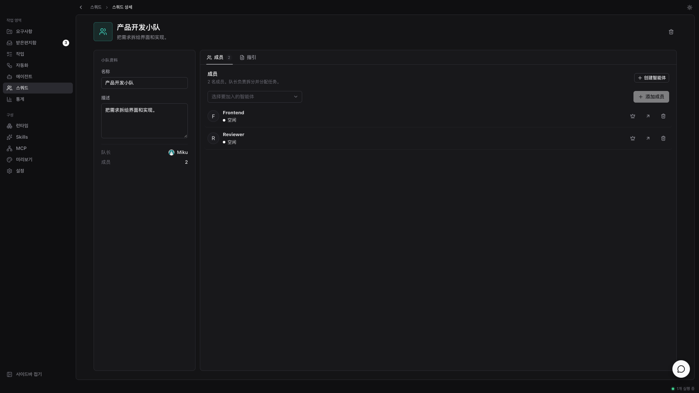
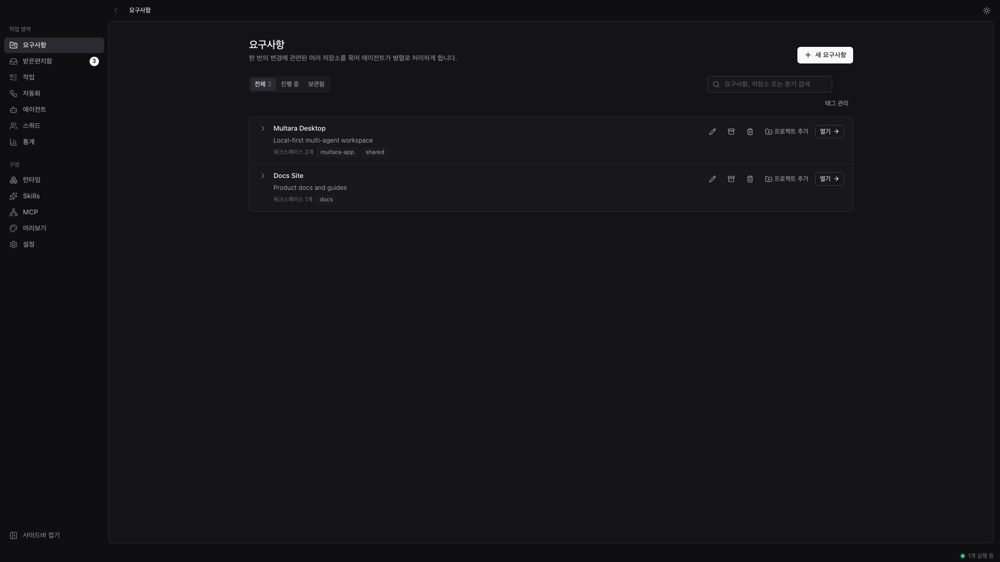
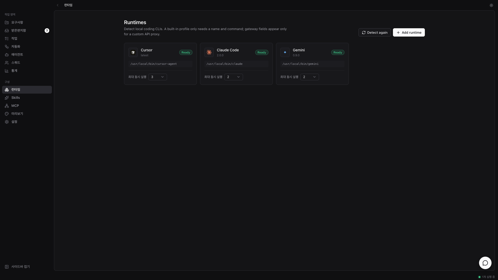
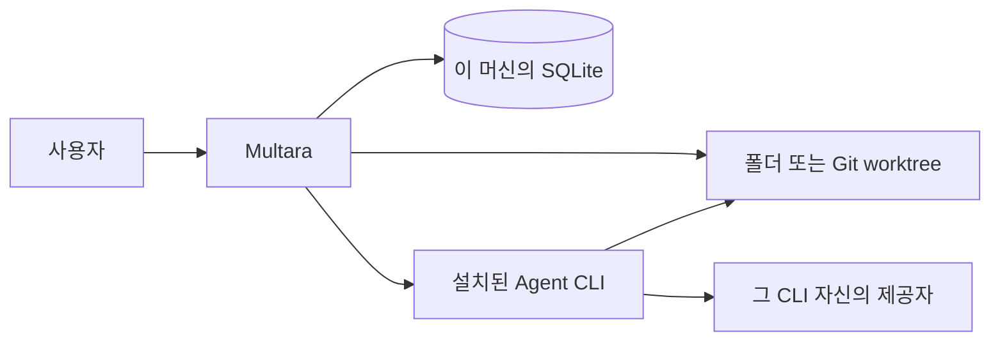

<div align="center">


# Multara

**로컬 우선 AI 코딩 워크벤치**

모든 AI 코딩 에이전트를 하나의 워크스페이스에서.

Multara는 여러 AI 코딩 에이전트를 쓰는 개발자를 위한 데스크톱 애플리케이션입니다. Claude Code, OpenAI Codex, Cursor Agent, 그리고 이 머신의 다른 CLI가 같은 워크스페이스를 씁니다. 실제 프로젝트 폴더, 작업, Monaco 에디터, Git, 그리고 에이전트 실행입니다.

[](https://github.com/tomiaa12/Multara/releases/latest)
[](https://github.com/tomiaa12/Multara/stargazers)


**[English](README.md) · [简体中文](README-zh-CN.md) · [繁體中文](README-zh-TW.md) · [日本語](README-ja.md) · 한국어**

<p>
  <a href="https://github.com/tomiaa12/Multara/releases/download/v1.14.0/Multara_1.14.0_x64-setup.exe"></a>
  &nbsp;
  <a href="https://github.com/tomiaa12/Multara/releases/download/v1.14.0/Multara_1.14.0_aarch64.dmg"></a>
  &nbsp;
  <a href="https://github.com/tomiaa12/Multara/releases/latest"></a>
</p>

</div>

<p align="center">
  
</p>

<p align="center">
  <sub><em>요구사항 작업대. 로컬 파일, Monaco 에디터, 에이전트 채팅이 한 창에 있습니다.</em></sub>
</p>

---

## 주요 기능

### 여러 에이전트, 하나의 워크스페이스

에이전트에는 이름, 런타임, 모델, 지침, 그리고 연결한 Skills와 MCP가 있습니다. 에이전트마다 다른 CLI를 동시에 쓸 수 있습니다. 런타임마다 동시 실행 한도가 있습니다.

요구사항 화면 밖에서도 채팅은 떠 있는 패널로 남습니다.

### 작업과 스쿼드

작업은 보드에 놓입니다. 에이전트에게 만들 수도 있고 스쿼드에게 만들 수도 있습니다. 스쿼드를 고르면 담당은 리더입니다. 보드는 에이전트별, 스쿼드별로 거를 수 있습니다.

스쿼드에는 리더와 다른 구성원이 있습니다. Multara는 리더를 먼저 실행하고, 그 실행이 끝나면 다른 구성원을 시작합니다.

받은편지함에는 요구사항, 작업, 떠 있는 채팅의 대화가 모입니다. 응답을 기다리는 항목도 여기에 있습니다.

### 로컬 폴더, 에디터, Git

요구사항은 한 작업에 쓰는 폴더를 묶습니다. Git 저장소는 현재 브랜치에서 열거나 Git worktree로 격리합니다. 새 브랜치를 만들거나 기존 브랜치를 체크아웃합니다. Git이 아닌 폴더는 그 디렉터리 그대로 엽니다.

작업대에는 파일 트리, 검색, Monaco 에디터, Git 패널, 터미널, 채팅이 있습니다. Git 패널에서 상태 확인, 스테이징, 커밋, pull, push를 할 수 있습니다.

### 실행을 본 다음 코드를 검토합니다

도구 호출, 명령, 편집은 채팅으로 흘러옵니다. 계획 모드는 승인할 때까지 기다릴 수 있습니다. 바뀐 파일은 Monaco에서 엽니다. 에디터에 저장하지 않은 내용이 있으면 Multara는 그것을 덮어쓰지 않습니다.

통계는 실행을 모읍니다. 그 실행이 기록한 토큰과 비용 숫자도 포함됩니다.

### 붙일 수 있는 것

- **Skills와 MCP.** Multara는 각 CLI가 이미 쓰는 skill 디렉터리와 MCP 설정을 읽고, 에이전트에 연결합니다.
- **자동화.** 일정이나 webhook으로 에이전트 또는 스쿼드를 실행합니다.
- **Feishu와 Lark.** 두 채널에서 에이전트나 스쿼드에게 메시지를 보낼 수 있습니다. 답장은 Multara에 저장됩니다.
- **모양.** 라이트와 다크. English, 简体中文, 繁體中文, 日本語, 한국어. 언어는 시스템을 따르거나 설정에서 고릅니다.
- **업데이트.** 앱은 GitHub Releases에서 스스로 업데이트합니다.

---

## 동작 방식

1. 요구사항에 로컬 폴더를 추가합니다. Git 저장소라면 worktree 또는 현재 디렉터리를 고릅니다.
2. 에이전트를 만들고, PATH에서 찾은 CLI에 연결합니다.
3. 작업이나 채팅을 그 에이전트 또는 스쿼드에게 보냅니다.
4. Multara는 워크스페이스 디렉터리에서 CLI를 시작합니다. CLI가 디스크의 파일을 수정하고 진행 상황을 돌려줍니다.
5. 채팅에서 실행을 읽고, Monaco에서 파일을 연 다음, 커밋할 때는 Git 패널을 씁니다.

Multara의 데이터는 로컬 SQLite에 있습니다. 모델을 포함하지 않고, 에이전트 CLI도 설치하지 않습니다.

## 창 하나로 모으는 이유

| | 따로 둔 터미널 | Multara |
| --- | --- | --- |
| 파일이 수정되는 곳 | 그 CLI를 시작한 디렉터리 | 연결한 폴더 또는 Git worktree |
| 일을 맡기는 방법 | 그 창의 프롬프트 | 에이전트나 스쿼드를 향한 작업과 채팅 |
| 나중에 보는 것 | 그 CLI의 출력 | 흐르는 실행, Monaco, Git 패널 |
| 어떤 CLI | 창마다 하나 | 설치하고 로그인한 지원 CLI |

이미 설치한 CLI를 그대로 씁니다. Multara는 그 바깥의 워크스페이스입니다.

---

## 지원하는 Agent CLI

Multara는 PATH에서 이 명령들을 찾습니다. 로그인은 각 CLI에서 합니다. 목록은 [`shared/cli-catalog.json`](shared/cli-catalog.json)과 같습니다.

| 에이전트 | 명령 | 에이전트 | 명령 |
| --- | --- | --- | --- |
| Claude Code | `claude` | Codex | `codex` |
| Cursor | `cursor-agent` | GitHub Copilot | `copilot` |
| OpenCode | `opencode` | Gemini CLI | `gemini` |
| Qwen Code | `qwen` | Kimi CLI | `kimi` |
| Antigravity | `agy` | CodeArts | `codearts` |
| CodeBuddy | `codebuddy` | DevEco | `deveco` |
| Dim | `dim` | DSH | `dsh` |
| Grok | `grok` | Hermes | `hermes` |
| Kiro | `kiro-cli` | MiniMax Code | `mcode` |
| OMP | `omp` | OpenClaw | `openclaw` |
| Pi | `pi` | Qoder | `qodercli` |
| Qoder CN | `qoderclicn` | QwenPaw | `qwenpaw` |
| Reasonix | `reasonix` | TRAE CLI | `traecli` |
| ZeroClaw | `zeroclaw` | | |

Cursor는 `agent`로도 감지됩니다. GitHub Copilot은 `github-copilot-cli`로도 감지됩니다. **런타임 → Add runtime**에서 다른 로컬 명령을 등록할 수 있습니다.

Claude Code, Codex, OpenCode, Gemini CLI, Qwen Code는 런타임에 API 기본 URL을 넣을 수도 있습니다.

---

## 설치

아래 파일은 [Multara v1.14.0](https://github.com/tomiaa12/Multara/releases/tag/v1.14.0)입니다. 더 새로운 빌드는 [릴리스 페이지](https://github.com/tomiaa12/Multara/releases/latest)에 있습니다.

| 플랫폼 | 다운로드 |
| --- | --- |
| Windows x64 | [NSIS `.exe`](https://github.com/tomiaa12/Multara/releases/download/v1.14.0/Multara_1.14.0_x64-setup.exe) · [MSI, en-US](https://github.com/tomiaa12/Multara/releases/download/v1.14.0/Multara_1.14.0_x64_en-US.msi) · [MSI, zh-CN](https://github.com/tomiaa12/Multara/releases/download/v1.14.0/Multara_1.14.0_x64_zh-CN.msi) |
| macOS Apple Silicon | [`.dmg`](https://github.com/tomiaa12/Multara/releases/download/v1.14.0/Multara_1.14.0_aarch64.dmg) |

`.exe` 설치 프로그램은 현재 사용자용입니다. Windows 설치는 WebView2가 없으면 그것을 내려받습니다. macOS는 10.15 이상이 필요합니다. `Multara.app`을 응용 프로그램 폴더로 끌어 넣습니다.

공개된 macOS 빌드는 공증되지 않았습니다. Gatekeeper가 앱이 손상되었다고 하면 격리 속성을 지웁니다.

```bash
xattr -cr /Applications/Multara.app
```

macOS Intel과 Linux 설치 파일은 공개되어 있지 않습니다. 설치 뒤에는 앱 안에서 업데이트할 수 있습니다.

## 빠른 시작

1. Multara와 [지원 CLI](#지원하는-agent-cli)를 하나 이상 설치합니다. 로그인은 그 CLI에서 마칩니다.
2. **런타임**을 열고 **Detect again**을 선택합니다. 찾은 CLI는 **Ready**, 경로, 동시 실행 한도를 보여 줍니다.
3. 에이전트를 만들고 이름을 붙인 뒤 그 런타임을 고릅니다. 첫 실행에는 Miku라는 에이전트가 이미 있습니다.
4. 요구사항을 만들고 로컬 폴더를 추가합니다. Git에서는 새 worktree 브랜치가 권장됩니다. 기존 브랜치를 worktree로 체크아웃하거나 현재 디렉터리에서 편집할 수도 있습니다.
5. 에이전트나 스쿼드의 작업을 만들거나, 요구사항을 열어 채팅을 보냅니다.
6. 흐르는 실행을 보고, 에디터와 Git 패널에서 파일을 검토합니다.

---

## 화면

<p align="center">
  
</p>

<p align="center">
  <sub><em>에이전트는 각자 런타임을 가집니다. 여기에는 Cursor, Claude Code, Gemini가 있습니다.</em></sub>
</p>

<p align="center">
  
  &nbsp;
  
</p>

<p align="center">
  <sub><em>작업은 보드에서 배정합니다. 스쿼드에는 리더와 구성원이 있습니다.</em></sub>
</p>

<p align="center">
  
  &nbsp;
  
</p>

<p align="center">
  <sub><em>요구사항은 로컬 폴더를 묶습니다. 런타임은 이 머신에서 찾은 CLI입니다.</em></sub>
</p>

같은 인터페이스의 다른 화면: [작업 상세](screenshots/ko/1920/task-detail.png), [받은편지함](screenshots/ko/1920/inbox.png), [Skills](screenshots/ko/1920/skills.png), [MCP](screenshots/ko/1920/mcp.png), [자동화](screenshots/ko/1920/automation.png), [통계](screenshots/ko/1920/stats.png), [설정](screenshots/ko/1920/settings.png).

---

## 로컬 우선

Multara는 데스크톱 앱입니다. 셸은 Tauri 2, 화면은 Vue 3, 로컬 서비스는 Rust입니다. 요구사항, 에이전트, 스쿼드, 채팅, 작업, 실행 대기열은 앱 데이터 디렉터리의 SQLite 파일 `multara.sqlite3`에 저장됩니다.



Multara 계정은 없습니다. 에이전트 실행은 작업 디렉터리가 워크스페이스인 로컬 CLI 프로세스입니다. 그 CLI는 자신의 로그인을 쓰고, 프롬프트를 자신의 제공자에게 보냅니다.

## 지원 플랫폼

| 플랫폼 | 공개된 설치 파일 |
| --- | --- |
| Windows x64 | `.exe`와 MSI (`en-US`, `zh-CN`) |
| macOS Apple Silicon | `.dmg`, macOS 10.15 이상 |
| macOS Intel | 공개되지 않음 |
| Linux | 공개되지 않음 |

## 로드맵

별도의 로드맵 문서는 없습니다. 진행 중인 일은 [issues](https://github.com/tomiaa12/Multara/issues)에 있고, 공개된 빌드는 [GitHub Releases](https://github.com/tomiaa12/Multara/releases)에 있습니다.

## 기여

Issue와 pull request를 받습니다.

릴리스 워크플로는 Node.js 22, pnpm 10, stable Rust를 사용합니다.

```bash
git clone https://github.com/tomiaa12/Multara.git
cd Multara
pnpm install
pnpm tauri:dev
```

로컬 폴더를 읽고 CLI를 시작할 수 있는 것은 `pnpm tauri:dev`입니다. `pnpm dev`는 화면만 제공합니다. `pnpm test`는 프론트엔드 단위 테스트를 실행합니다. `pnpm build`는 프론트엔드 타입 검사와 웹 번들 생성을 합니다.

## 라이선스

이 저장소에는 라이선스 파일이 없습니다. Copyright © 2026 Multara.
