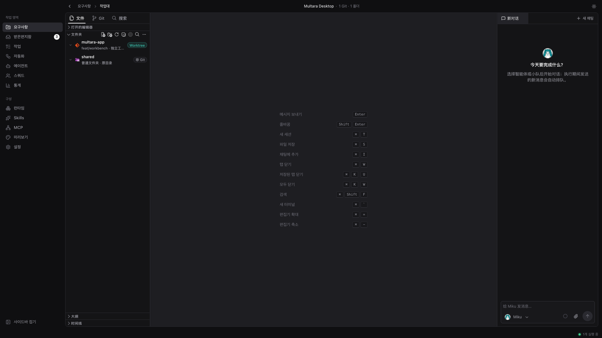
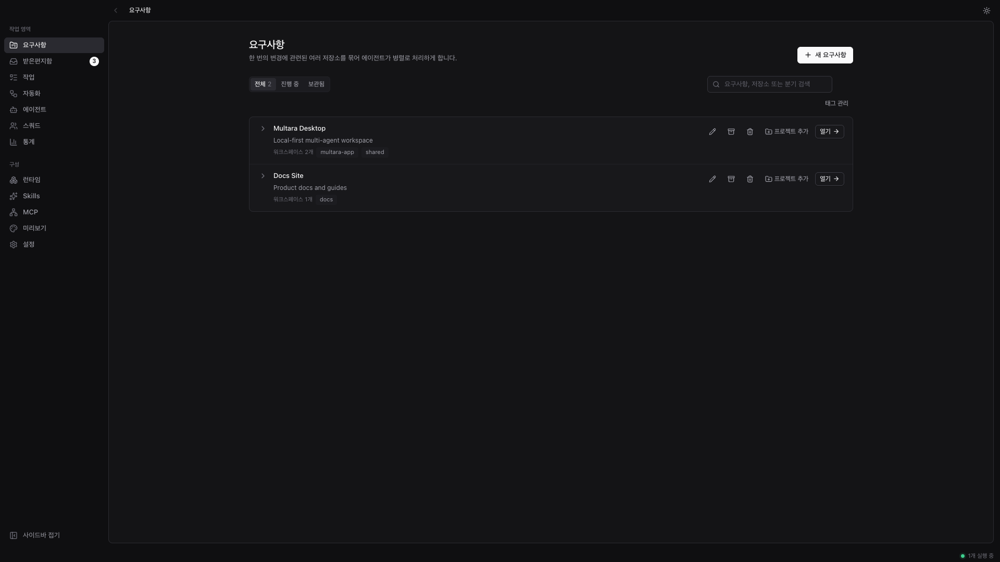
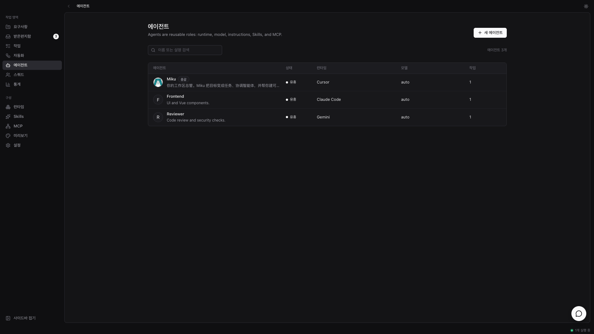
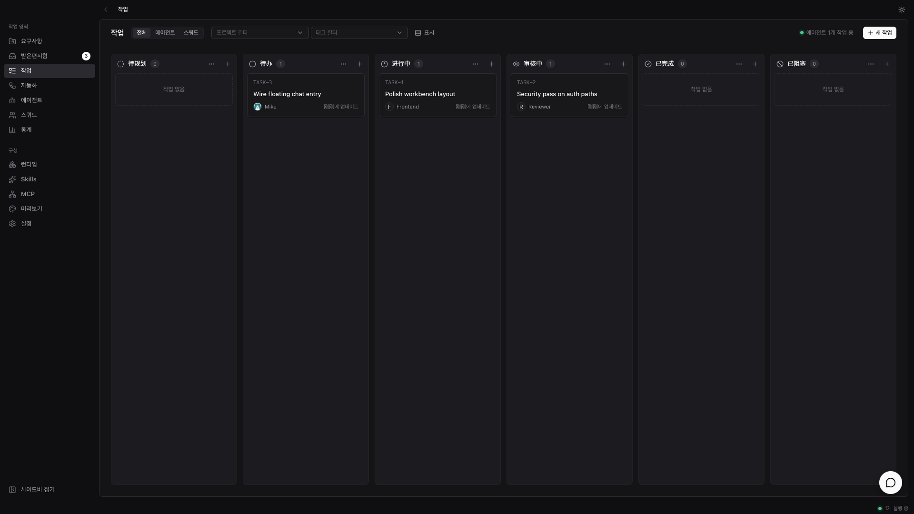
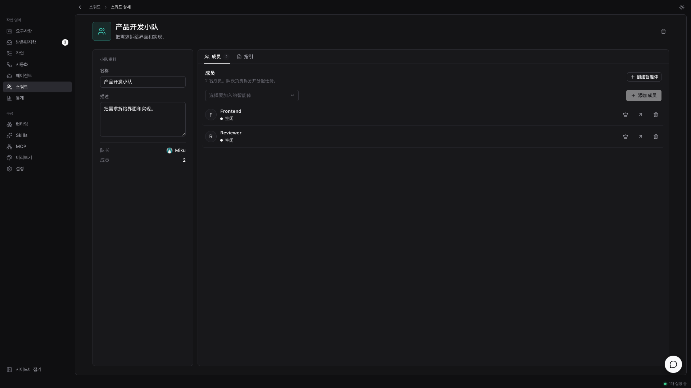

<div align="center">


# Multara

**에이전트는 내 컴퓨터에서 일한다.**

Multara는 로컬 우선 데스크톱 워크스페이스입니다. 동료에게 일을 맡기듯 AI 코딩 에이전트에게 작업을
넘기면——스스로 인수하고, 실제 폴더를 수정하며, 진행을 보고하고, 검토를 위해 돌려줍니다. 이미 쓰는
에이전트 CLI를 지원합니다. 클라우드 계정 불필요, 벤더 종속성 없음.

[](https://github.com/tomiaa12/Multara/releases)


**[English](README.md) · [简体中文](README-zh-CN.md) · [繁體中文](README-zh-TW.md) · [日本語](README-ja.md) · 한국어**

</div>

<p align="center">
  
</p>

<p align="center">
  <sub><em>하나의 로컬 워크스페이스 — 프로젝트, 에이전트, 검토가 같은 창에.</em></sub>
</p>

<p align="center">
  
  &nbsp;
  
</p>

<p align="center">
  
  &nbsp;
  
</p>

---

## Multara란

이미 Claude Code, Codex, 다른 에이전트를 동시에 돌리고 있을 겁니다. 각각은 자기 터미널 탭에
갇혀 있고, 세션이 끝나면 아무것도 기억하지 않으며, 같은 맥락을 오늘만 네 번째로 설명하게 됩니다.
에이전트를 늘릴수록 돌보는 시간만 늘어납니다.

Multara는 그 에이전트들을 하나의 로컬 워크스페이스에 둡니다. 작업을 맡기면 스스로 인수하고, 내가
통제하는 폴더에서 일하며, 진행을 스트리밍하고, 결과를 검토로 넘깁니다. 의도, 실행, diff가
이어진 채——맥락을 다시 짜지 않아도 되고, 내가 보기 전에는 확정되지 않습니다.

---

## 팀을 만든다

*Claude Code, Codex, Cursor, Kimi——하나만 고르지 말고 전부 채용.*

- **이미 쓰는 에이전트 CLI →** Claude Code, Codex, Cursor, Copilot, Kimi, OpenCode, Gemini, Qwen 등.
- **에이전트도 동료 →** 이름, 프로바이더, 런타임을 주면 다른 멤버처럼 올라옵니다.
- **스쿼드 →** 에이전트를 한 팀으로. 리더가 일을 배분합니다.
- **Skills →** 한 번 푼 문제를 플레이북으로, 어떤 에이전트든 재사용.
- **MCP →** 에이전트에 필요한 도구를 연결.
- **내 컴퓨터가 런타임 →** 코드는 밖으로 나가지 않음. 설치된 CLI를 자동 감지.

## 일을 넘긴다

*처음엔 채팅이나 작업의 몇 줄. 끝은 디스크에서 검토할 수 있는 변경.*

- **프로젝트 →** 작업을 묶고, 에이전트가 쓸 로컬 폴더를 붙입니다.
- **워크벤치 →** 파일 트리, Monaco, Git 상태, 채팅을 한 화면에.
- **워크스페이스 격리 →** 폴더를 직접 열거나 `git worktree` / 폴더 복사로 격리.
- **작업과 자동화 →** 채팅 밖에서도 추적. 예약 작업 실행.
- **채팅 →** 워크벤치에서 대화하거나, 페이지를 떠나지 않는 플로팅 채팅.
- **에이전트 또는 스쿼드 지정 →** 동료를 고르듯 담당을 정합니다.

## 상황을 본다

*어느 에이전트가 건드렸나? 무엇을 바꿨나? 실행과 diff를 연다.*

- **스트리밍 실행 →** 도구 호출, 명령, 편집을 실시간으로.
- **에디터에서 검토 →** 변경은 디스크에 착지. 워크벤치에서 유지·수정·폐기.
- **Git 패널 →** 같은 창에서 상태, 스테이징, 커밋.
- **통계 →** 에이전트 사용을 시간에 따라 확인.
- **필요할 때만 →** 판단이 필요할 때만 돌아오고, 매 단계마다 부르지 않음.

## 내 것으로 만든다

*내 머신, 내 폴더, 내 규칙——기본은 로컬 우선.*

- **로컬 우선 →** 프로젝트, 에이전트, 스쿼드, 채팅, 실행 큐는 본기 SQLite.
- **라이트 / 다크 테마**
- **English · 简体中文 · 繁體中文 · 日本語 · 한국어** — 시스템 언어를 따르거나 설정에서 선택
- **인앱 업데이트**（GitHub Releases）

---

## 시작하기

1. Windows 또는 macOS용 **[Multara](https://github.com/tomiaa12/Multara/releases/latest)** 를 다운로드.
2. [지원 에이전트 CLI](#런타임)를 하나 이상 설치하고 로그인——Multara는 구동만 하며, 함께 제공하지 않습니다.
3. Multara를 열고 로컬 폴더가 있는 프로젝트를 추가한 뒤, 에이전트를 만들고 일을 맡깁니다.

| 플랫폼 | 설치 파일 |
| --- | --- |
| Windows | `.exe` 또는 `.msi` |
| macOS（Apple Silicon） | `.dmg` |
| macOS（Intel） | `.dmg` |

macOS에서는 `Multara.app`을「응용 프로그램」으로 드래그하세요. 「손상되었기 때문에 열 수 없습니다」라고 나오면 터미널에서 다음을 실행하세요:

```bash
xattr -cr /Applications/Multara.app
```

---

## 런타임

Multara는 모델을 포함하지 않습니다. 이미 설치·인증된 에이전트 CLI를 구동합니다——
프로바이더 전환은 드롭다운이지, 마이그레이션이 아닙니다.

| 프로바이더 | CLI | 프로바이더 | CLI |
| --- | --- | --- | --- |
| Claude Code | `claude` | OpenAI Codex | `codex` |
| Cursor Agent | `cursor-agent` | GitHub Copilot CLI | `copilot` |
| OpenCode | `opencode` | Gemini | `gemini` |
| Qwen Code | `qwen` | Kimi | `kimi` |
| Grok | `grok` | CodeBuddy | `codebuddy` |
| OpenClaw | `openclaw` | Hermes | `hermes` |
| Pi | `pi` | Antigravity | `agy` |
| Kiro CLI | `kiro-cli` | Qoder CLI | `qodercli` |
| Trae CLI | `traecli` | MiniMax Code | `mcode` |
| …그 외 | | | |

---

## 영감

보드 위의 에이전트, 동료처럼 일을 넘기는 방식. Multara는 그 생각을 로컬 우선 데스크톱 워크스페이스로 옮깁니다.
