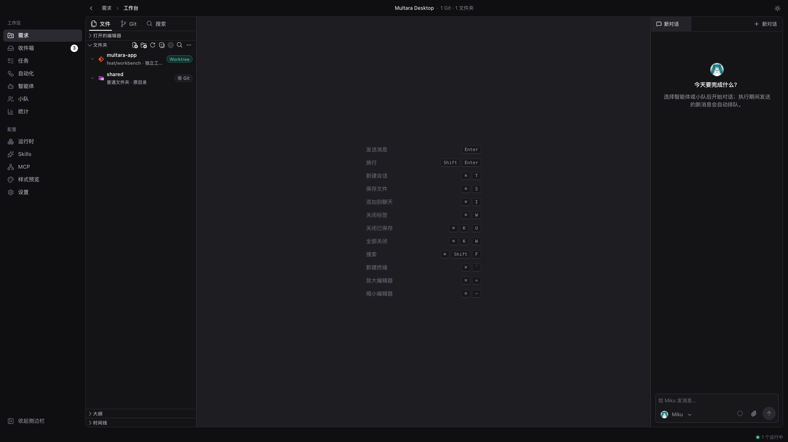
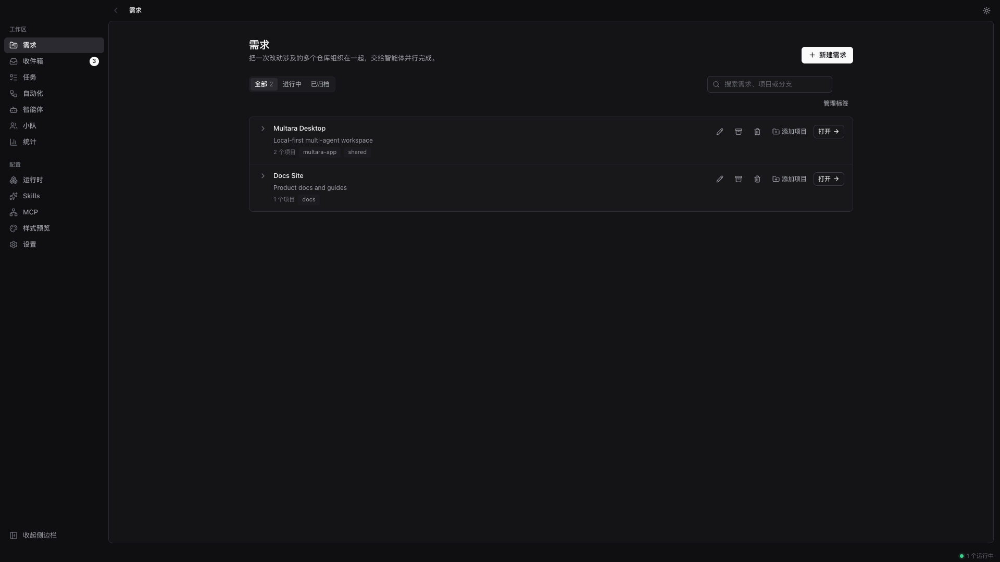
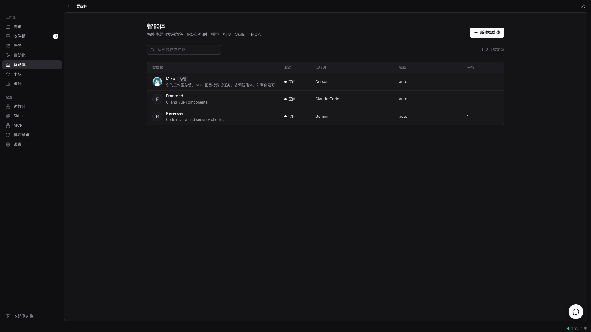
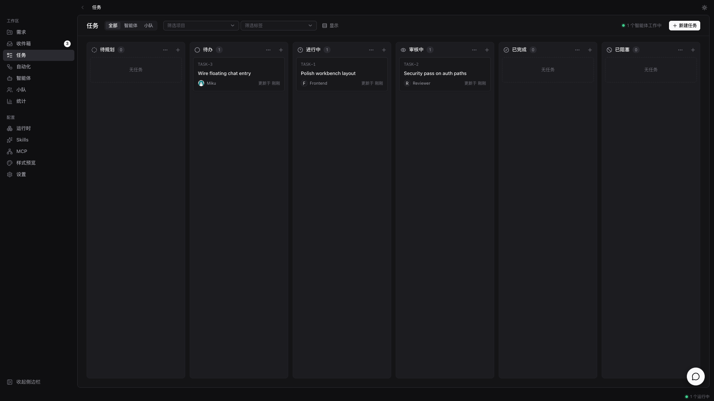
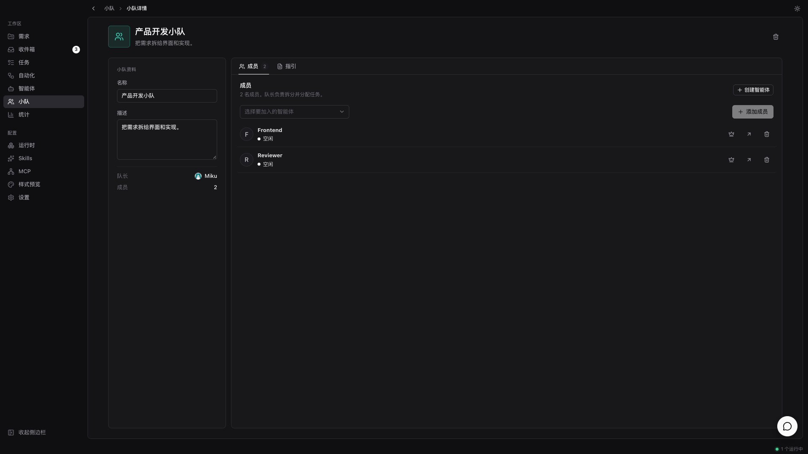

<div align="center">


# Multara

**智能体，在你自己的机器上干活。**

Multara 是一个本地优先的桌面工作区。你像给同事派活一样，把任务交给 AI 编码智能体——它自己接手、
改真实目录、边做边汇报，做完交回来给你审。支持你已经在用的智能体 CLI，不需要云账号，不绑定厂商。

[](https://github.com/tomiaa12/Multara/releases)


**[English](README.md) · 简体中文 · [繁體中文](README-zh-TW.md) · [日本語](README-ja.md) · [한국어](README-ko.md)**

</div>

<p align="center">
  
</p>

<p align="center">
  <sub><em>一个本机工作区——项目、智能体与审阅都在同一窗口。</em></sub>
</p>

<p align="center">
  
  &nbsp;
  
</p>

<p align="center">
  
  &nbsp;
  
</p>

---

## Multara 是什么

你手上已经同时开着 Claude Code、Codex，还有另外三个智能体。每一个都关在自己的终端标签页里，会话
一关就什么都不记得，同一段上下文你今天已经讲到第四遍。结果是智能体越加越多，你越忙。

Multara 把这些智能体放进同一个本机工作区。任务派给智能体，它自己接手，在你控制的目录里跑，边做边
流式汇报，做完交回来等你验收。从最初的想法，到中间的每一次执行，再到最后的 diff，都挂在一起——
不用反复重讲上下文，也没有任何东西能不经你过目就落盘定稿。

---

## 组一支队伍

*Claude Code、Codex、Cursor、Kimi——不用挑一个，全都招进来。*

- **你已经在用的智能体 CLI →** Claude Code、Codex、Cursor、Copilot、Kimi、OpenCode、Gemini、Qwen 等等。
- **智能体也是队友 →** 起个名字、选个提供方、配好运行时，它就和其他同事一样上线。
- **小队 →** 把智能体编成一队，由队长分配活。
- **Skills →** 解决过一次的问题沉淀下来，全队智能体都能复用。
- **MCP →** 接上智能体需要的工具。
- **你的机器就是运行时 →** 代码不出门。Multara 自动检测本机已安装的 CLI。

## 把活交出去

*一开始只是聊天或任务里的几句话，最后变成磁盘上可审阅的改动。*

- **项目 →** 把工作归类，挂上智能体要用的本机目录。
- **工作台 →** 文件树、Monaco 编辑器、Git 状态与聊天同一视图。
- **工作区隔离 →** 可直接打开目录，也可用 `git worktree` / 文件夹拷贝做隔离。
- **任务与自动化 →** 在聊天之外跟踪工作；跑定时任务。
- **聊天 →** 在工作台对话，或用不离开当前页的浮动聊天。
- **指派智能体或小队 →** 像挑同事一样挑谁来接活。

## 看得见，也管得住

*这活哪个智能体动过？改了什么？点开运行记录和 diff。*

- **流式执行 →** 工具调用、命令和改动实时可见。
- **编辑器里审阅 →** 智能体改动落在磁盘上；你在工作台里保留、修改或丢弃。
- **Git 面板 →** 同一窗口查看状态、暂存与提交。
- **统计 →** 看智能体随时间的使用情况。
- **按需回来 →** 只在需要你拍板时跳回来，而不是每一步都打断你。

## 整套都归你

*你的机器、你的目录、你的规矩——默认本地优先。*

- **本地优先 →** 项目、智能体、小队、对话与运行队列都存在本机 SQLite。
- **浅色 / 深色主题**
- **English · 简体中文 · 繁體中文 · 日本語 · 한국어** — 默认跟随系统语言，也可在设置里切换
- **应用内更新**，来自 GitHub Releases

---

## 开始使用

1. 下载 **[Multara](https://github.com/tomiaa12/Multara/releases/latest)**（Windows 或 macOS）。
2. 安装并登录至少一个[受支持的智能体 CLI](#运行时)——Multara 负责驱动它们，但不替你安装。
3. 打开 Multara，添加带本机目录的项目，创建智能体，然后派活给它。

| 平台 | 安装包 |
| --- | --- |
| Windows | `.exe` 或 `.msi` |
| macOS（Apple Silicon） | `.dmg` |
| macOS（Intel） | `.dmg` |

macOS 上将 `Multara.app` 拖进「应用程序」。若提示「已损坏，无法打开」，在终端执行：

```bash
xattr -cr /Applications/Multara.app
```

---

## 运行时

Multara 不内置模型。它驱动你本机已经安装并登录好的智能体 CLI——换提供方只是下拉框，不是迁移。

| 提供方 | CLI | 提供方 | CLI |
| --- | --- | --- | --- |
| Claude Code | `claude` | OpenAI Codex | `codex` |
| Cursor Agent | `cursor-agent` | GitHub Copilot CLI | `copilot` |
| OpenCode | `opencode` | Gemini | `gemini` |
| Qwen Code | `qwen` | Kimi | `kimi` |
| Grok | `grok` | CodeBuddy | `codebuddy` |
| OpenClaw | `openclaw` | Hermes | `hermes` |
| Pi | `pi` | Antigravity | `agy` |
| Kiro CLI | `kiro-cli` | Qoder CLI | `qodercli` |
| Trae CLI | `traecli` | MiniMax Code | `mcode` |
| …以及更多 | | | |

---

## 灵感来源

Multara 的灵感来自 [Multica](https://github.com/multica-ai/multica)——智能体也在看板上，
像队友一样接活。Multara 把这一想法落到本地优先的桌面工作区。
