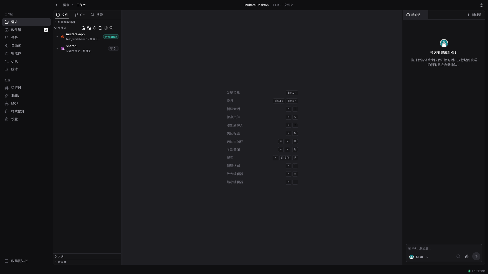
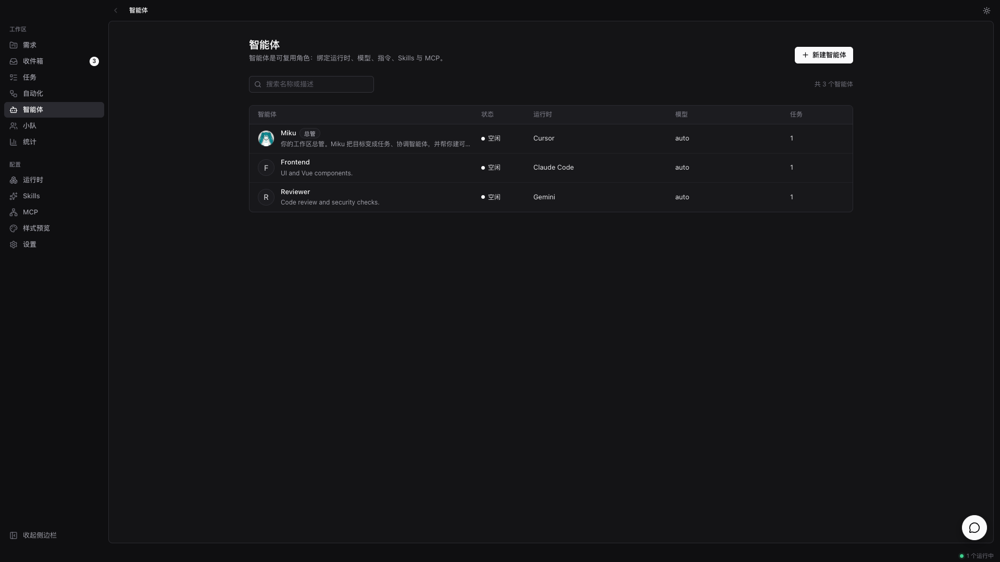
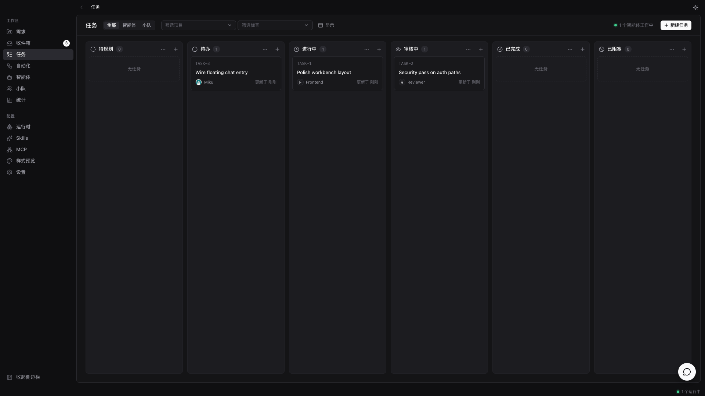
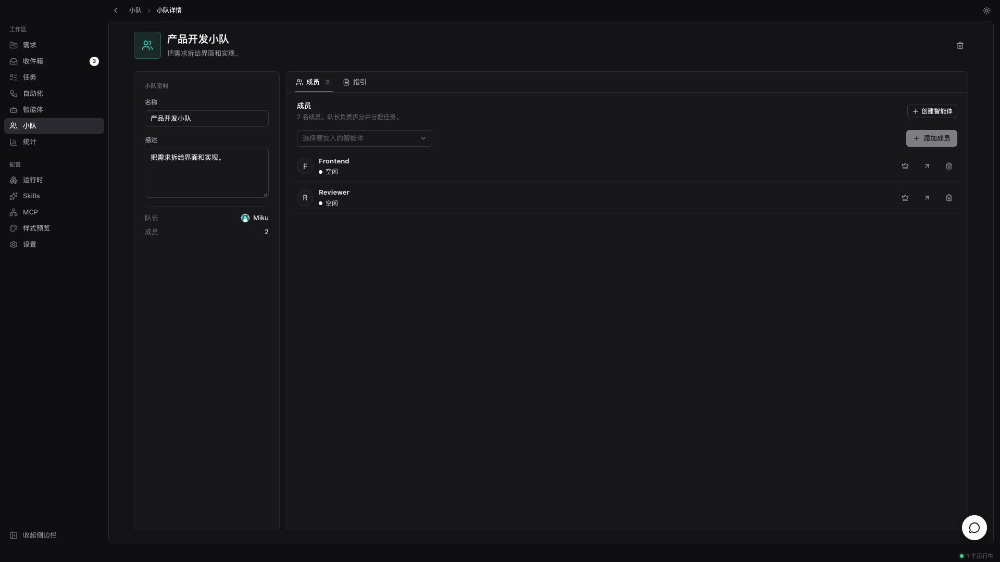
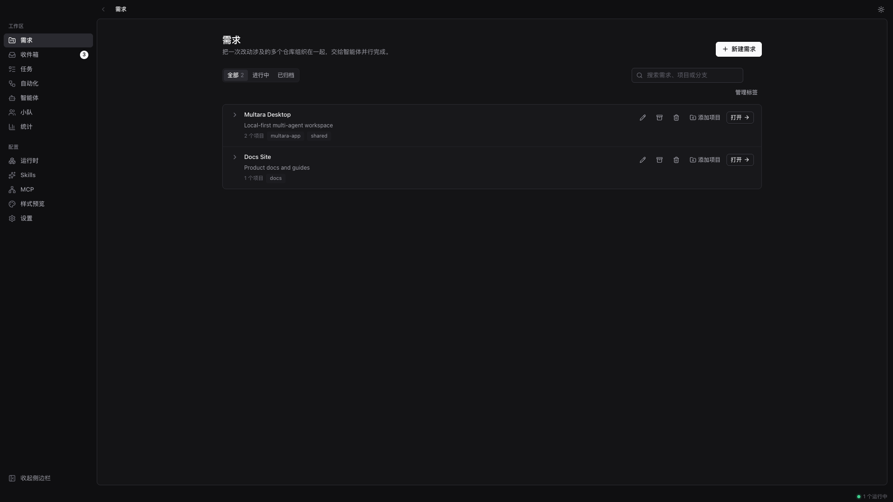
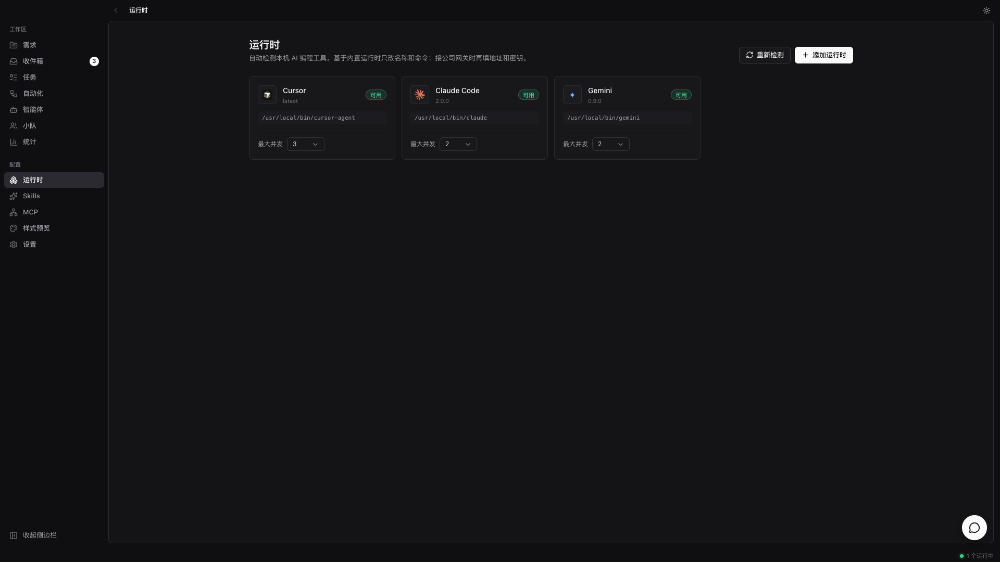
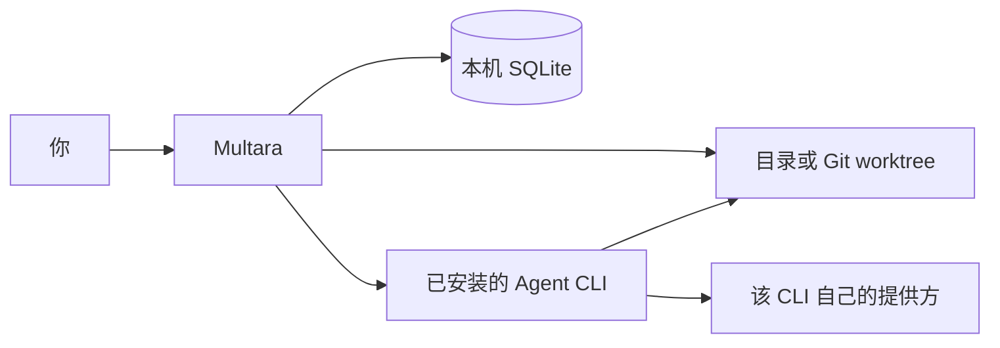

<div align="center">


# Multara

**本地优先的 AI 编程工作台**

一个工作区，容纳每一个 AI 编程智能体。

Multara 是给同时使用多个 AI 编程智能体的开发者准备的桌面应用。Claude Code、OpenAI Codex、Cursor Agent，以及本机上的其他 CLI，共用同一个工作区：真实的项目目录、任务、Monaco 编辑器、Git，以及智能体的这次运行。

[](https://github.com/tomiaa12/Multara/releases/latest)
[](https://github.com/tomiaa12/Multara/stargazers)


**[English](README.md) · 简体中文 · [繁體中文](README-zh-TW.md) · [日本語](README-ja.md) · [한국어](README-ko.md)**

<p>
  <a href="https://github.com/tomiaa12/Multara/releases/download/v1.14.0/Multara_1.14.0_x64-setup.exe"></a>
  &nbsp;
  <a href="https://github.com/tomiaa12/Multara/releases/download/v1.14.0/Multara_1.14.0_aarch64.dmg"></a>
  &nbsp;
  <a href="https://github.com/tomiaa12/Multara/releases/latest"></a>
</p>

</div>

<p align="center">
  
</p>

<p align="center">
  <sub><em>需求工作台：本地文件、Monaco 编辑器和智能体聊天在同一个窗口。</em></sub>
</p>

---

## 主要能力

### 多个智能体，一个工作区

每个智能体有自己的名称、运行时、模型、说明，以及你挂上的 Skills 和 MCP。不同智能体可以同时使用不同的 CLI。每个运行时有自己的并发上限。

离开需求页之后，聊天仍然以浮动面板留在窗口里。

### 任务和小队

任务放在看板上。可以派给一个智能体，也可以派给一个小队；派给小队时，负责人是队长。看板可以按智能体或小队筛选。

小队有队长和其他成员。Multara 先运行队长，这一轮结束后再运行其他成员。

收件箱汇集需求、任务和浮动聊天里的对话，也包括正等你处理的那些。

### 本地目录、编辑器和 Git

一个需求挂上一组本地目录。Git 仓库可以在当前分支上直接改，也可以隔离成 Git worktree：新建分支，或迁出已有分支。普通文件夹按原目录打开。

工作台把文件树、搜索、Monaco 编辑器、Git 面板、终端和聊天放在同一个视图里。Git 面板可以查看状态、暂存、提交、拉取和推送。

### 先看运行，再审代码

工具调用、命令和文件改动会流式出现在聊天里。规划模式可以停下来，等你批准计划。改过的文件可以在 Monaco 里打开。编辑器里还有未保存的内容时，Multara 不会覆盖它们。

统计汇总这些运行，包括运行记录里的 token 和费用数字。

### 还能接上什么

- **Skills 和 MCP。** Multara 读取这些 CLI 已经在用的 skill 目录和 MCP 配置，再挂到智能体上。
- **自动化。** 按时间或通过 webhook 运行一个智能体或小队。
- **飞书和 Lark。** 从这两个渠道给智能体或小队发消息，回复保存在 Multara 里。
- **外观。** 浅色或深色主题。English、简体中文、繁體中文、日本語、한국어。语言跟随系统，也可以在设置里指定。
- **更新。** 应用从 GitHub Releases 在内部更新。

---

## 怎么工作

1. 给需求添加本地目录。Git 仓库可以选择 worktree，或直接使用当前目录。
2. 创建一个智能体，绑定 Multara 在 PATH 上找到的 CLI。
3. 把任务或一条聊天交给这个智能体，或交给一个小队。
4. Multara 在工作区目录里启动 CLI。CLI 自己改磁盘上的文件，并把进度流式送回来。
5. 在聊天里看这次运行，用 Monaco 打开文件，准备提交时使用 Git 面板。

Multara 把自己的数据放在本机 SQLite 里。它不附带模型，也不负责安装这些智能体 CLI。

## 为什么放在一个窗口里

| | 分开的终端 | Multara |
| --- | --- | --- |
| 文件改在哪里 | 启动那个 CLI 时的目录 | 你挂上的目录或 Git worktree |
| 工作怎么派 | 那个窗口里的一段提示 | 指向智能体或小队的任务、聊天 |
| 之后看什么 | 那个 CLI 的输出记录 | 流式运行、Monaco 和 Git 面板 |
| 用哪个 CLI | 一个窗口一个 | 本机已安装并登录的受支持 CLI |

你继续使用自己安装的 CLI。Multara 是包在它们外面的工作区。

---

## 支持的 Agent CLI

Multara 在 PATH 上查找这些命令。登录在 CLI 自己里面完成。名单与 [`shared/cli-catalog.json`](shared/cli-catalog.json) 一致。

| 智能体 | 命令 | 智能体 | 命令 |
| --- | --- | --- | --- |
| Claude Code | `claude` | Codex | `codex` |
| Cursor | `cursor-agent` | GitHub Copilot | `copilot` |
| OpenCode | `opencode` | Gemini CLI | `gemini` |
| Qwen Code | `qwen` | Kimi CLI | `kimi` |
| Antigravity | `agy` | CodeArts | `codearts` |
| CodeBuddy | `codebuddy` | DevEco | `deveco` |
| Dim | `dim` | DSH | `dsh` |
| Grok | `grok` | Hermes | `hermes` |
| Kiro | `kiro-cli` | MiniMax Code | `mcode` |
| OMP | `omp` | OpenClaw | `openclaw` |
| Pi | `pi` | Qoder | `qodercli` |
| Qoder CN | `qoderclicn` | QwenPaw | `qwenpaw` |
| Reasonix | `reasonix` | TRAE CLI | `traecli` |
| ZeroClaw | `zeroclaw` | | |

Cursor 也会被识别为 `agent`。GitHub Copilot 也会被识别为 `github-copilot-cli`。**运行时 → 添加运行时**可以登记另一个本机命令。

Claude Code、Codex、OpenCode、Gemini CLI 和 Qwen Code 还可以使用你在运行时上填写的 API 地址。

---

## 安装

下面的文件来自 [Multara v1.14.0](https://github.com/tomiaa12/Multara/releases/tag/v1.14.0)。更新的构建在[发行版页面](https://github.com/tomiaa12/Multara/releases/latest)。

| 平台 | 下载 |
| --- | --- |
| Windows x64 | [NSIS `.exe`](https://github.com/tomiaa12/Multara/releases/download/v1.14.0/Multara_1.14.0_x64-setup.exe) · [MSI，en-US](https://github.com/tomiaa12/Multara/releases/download/v1.14.0/Multara_1.14.0_x64_en-US.msi) · [MSI，zh-CN](https://github.com/tomiaa12/Multara/releases/download/v1.14.0/Multara_1.14.0_x64_zh-CN.msi) |
| macOS Apple Silicon | [`.dmg`](https://github.com/tomiaa12/Multara/releases/download/v1.14.0/Multara_1.14.0_aarch64.dmg) |

`.exe` 安装包按当前用户安装。Windows 安装过程在缺少 WebView2 时会下载它。macOS 需要 10.15 或更高版本。把 `Multara.app` 拖进“应用程序”。

已发布的 macOS 构建没有公证。如果 Gatekeeper 提示应用已损坏，清掉隔离属性：

```bash
xattr -cr /Applications/Multara.app
```

macOS Intel 和 Linux 的安装包没有发布。安装之后，可以在应用内更新。

## 快速开始

1. 安装 Multara，并安装至少一个[受支持的 CLI](#支持的-agent-cli)。用该 CLI 自己的方式完成登录。
2. 打开**运行时**，选择**重新检测**。找到的 CLI 会显示**可用**、路径和并发上限。
3. 创建智能体，起名，并选中这个运行时。首次启动已经带有一个名为 Miku 的智能体。
4. 新建需求并添加本地目录。Git 仓库建议新建 worktree 分支，也可以把已有分支迁出为 worktree，或在当前目录修改。
5. 为智能体或小队创建任务，或者打开需求并发送聊天。
6. 看流式运行，再在编辑器和 Git 面板里审阅文件。

---

## 界面

<p align="center">
  
</p>

<p align="center">
  <sub><em>每个智能体使用自己的运行时。这里是 Cursor、Claude Code 和 Gemini。</em></sub>
</p>

<p align="center">
  
  &nbsp;
  
</p>

<p align="center">
  <sub><em>任务在看板上指派。小队写明队长和成员。</em></sub>
</p>

<p align="center">
  
  &nbsp;
  
</p>

<p align="center">
  <sub><em>需求把本地目录分组。运行时是这台机器上找到的 CLI。</em></sub>
</p>

同一套界面还有：[任务详情](screenshots/zh-CN/1920/task-detail.png)、[收件箱](screenshots/zh-CN/1920/inbox.png)、[Skills](screenshots/zh-CN/1920/skills.png)、[MCP](screenshots/zh-CN/1920/mcp.png)、[自动化](screenshots/zh-CN/1920/automation.png)、[统计](screenshots/zh-CN/1920/stats.png)、[设置](screenshots/zh-CN/1920/settings.png)。

---

## 本地优先

Multara 是桌面应用。外壳是 Tauri 2，界面是 Vue 3，本机服务是 Rust。需求、智能体、小队、聊天、任务和运行队列保存在应用数据目录的 SQLite 文件 `multara.sqlite3` 里。



Multara 没有自己的账号。一次智能体运行就是一个本机 CLI 进程，工作目录是这个工作区。这个 CLI 仍使用它自己的登录，并把提示发给它自己的提供方。

## 支持的平台

| 平台 | 已发布的安装包 |
| --- | --- |
| Windows x64 | `.exe` 和 MSI（`en-US`、`zh-CN`） |
| macOS Apple Silicon | `.dmg`，macOS 10.15 或更高 |
| macOS Intel | 未发布 |
| Linux | 未发布 |

## 路线图

没有单独的路线图文档。进行中的工作记在 [issues](https://github.com/tomiaa12/Multara/issues)，已发布的构建列在 [GitHub Releases](https://github.com/tomiaa12/Multara/releases)。

## 参与贡献

欢迎提 issue 和 pull request。

发布流程使用 Node.js 22、pnpm 10 和 stable Rust。

```bash
git clone https://github.com/tomiaa12/Multara.git
cd Multara
pnpm install
pnpm tauri:dev
```

`pnpm tauri:dev` 才是能读取本地目录并启动 CLI 的应用。`pnpm dev` 只提供界面。`pnpm test` 运行前端单元测试。`pnpm build` 做前端类型检查并产出网页包。

## 许可证

这个仓库还没有许可证文件。Copyright © 2026 Multara。
