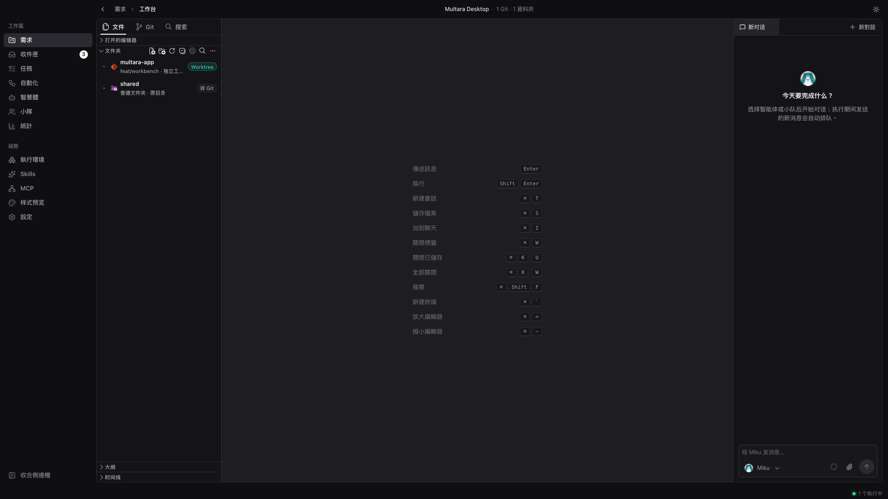
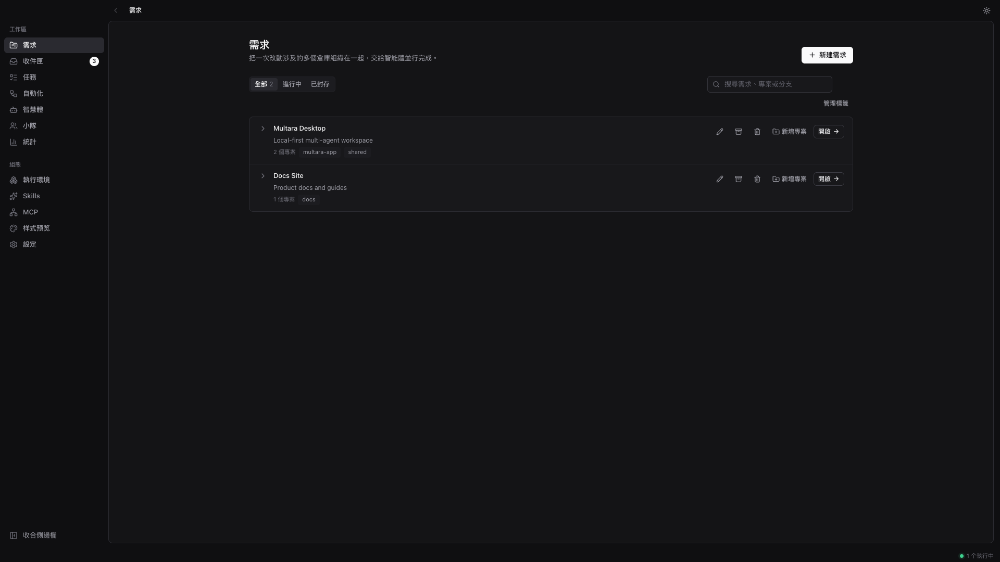
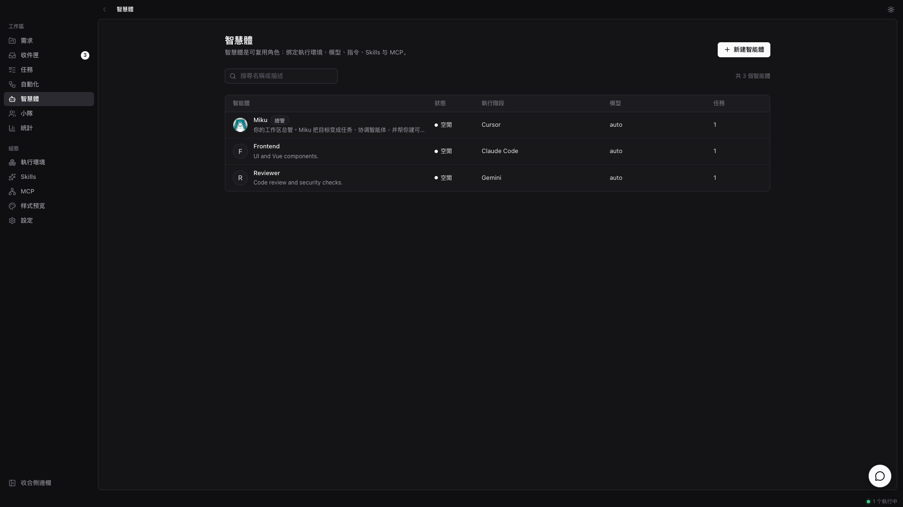
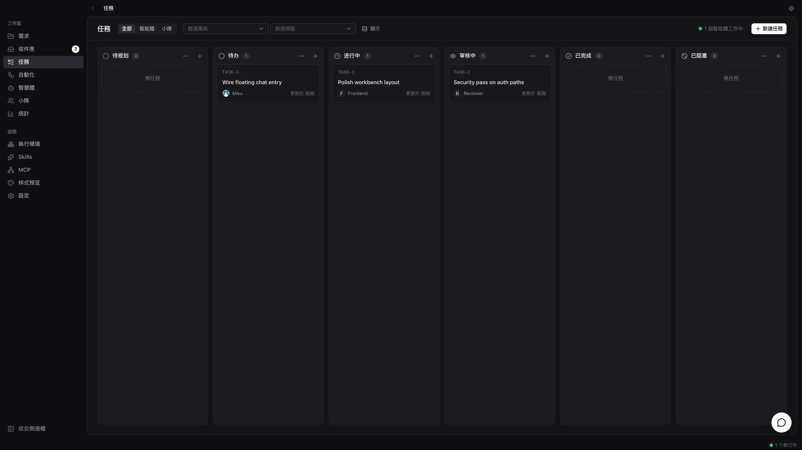
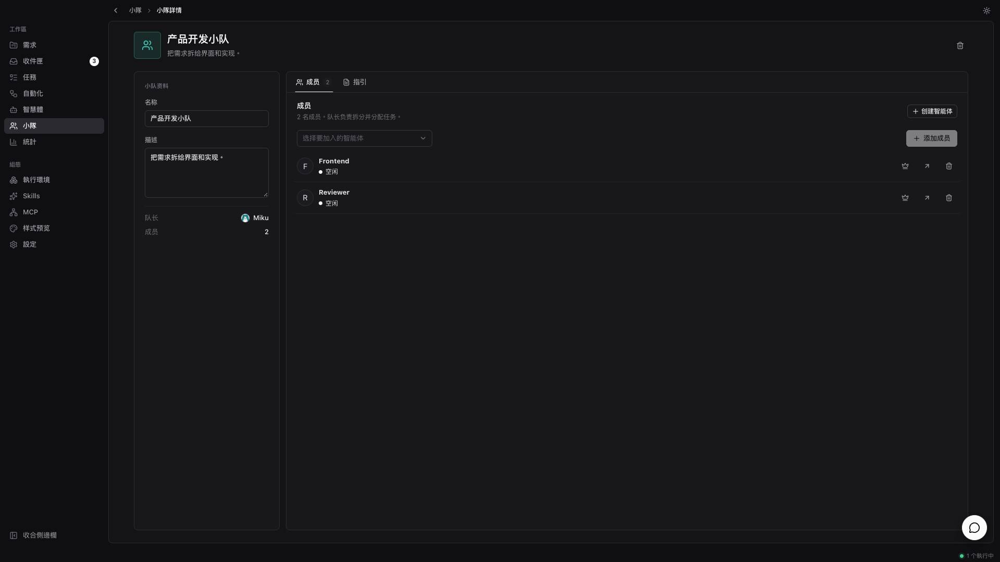

<div align="center">


# Multara

**智能體，在你自己的機器上干活。**

Multara 是一個本地優先的桌面工作區。你像給同事派活一樣，把任務交給 AI 編碼智能體——它自己接手、
改真實目錄、邊做邊回報，做完交回來給你審。支援你已經在用的智能體 CLI，不需要雲帳號，不綁定廠商。

[](https://github.com/tomiaa12/Multara/releases)


**[English](README.md) · [简体中文](README-zh-CN.md) · 繁體中文 · [日本語](README-ja.md) · [한국어](README-ko.md)**

</div>

<p align="center">
  
</p>

<p align="center">
  <sub><em>一個本機工作區——專案、智能體與審閱都在同一視窗。</em></sub>
</p>

<p align="center">
  
  &nbsp;
  
</p>

<p align="center">
  
  &nbsp;
  
</p>

---

## Multara 是什麼

你手上已經同時開著 Claude Code、Codex，還有另外三個智能體。每一個都關在自己的終端標籤頁裡，會話
一關就什麼都不記得，同一段上下文你今天已經講到第四遍。結果是智能體越加越多，你越忙。

Multara 把這些智能體放進同一個本機工作區。任務派給智能體，它自己接手，在你控制的目錄裡跑，邊做邊
串流回報，做完交回來等你驗收。從最初的想法，到中間的每一次執行，再到最後的 diff，都掛在一起——
不用反覆重講上下文，也沒有任何東西能不經你過目就落盤定稿。

---

## 組一支隊伍

*Claude Code、Codex、Cursor、Kimi——不用挑一個，全都招進來。*

- **你已經在用的智能體 CLI →** Claude Code、Codex、Cursor、Copilot、Kimi、OpenCode、Gemini、Qwen 等等。
- **智能體也是隊友 →** 起個名字、選個提供方、配好執行環境，它就和其他同事一樣上線。
- **小隊 →** 把智能體編成一隊，由隊長分配活。
- **Skills →** 解決過一次的問題沉澱下來，全隊智能體都能複用。
- **MCP →** 接上智能體需要的工具。
- **你的機器就是執行環境 →** 程式碼不出門。Multara 自動偵測本機已安裝的 CLI。

## 把活交出去

*一開始只是聊天或任務裡的幾句話，最後變成磁碟上可審閱的變更。*

- **專案 →** 把工作歸類，掛上智能體要用的本機目錄。
- **工作台 →** 檔案樹、Monaco 編輯器、Git 狀態與聊天同一檢視。
- **工作區隔離 →** 可直接開啟目錄，也可用 `git worktree` / 資料夾複製做隔離。
- **任務與自動化 →** 在聊天之外追蹤工作；跑排程任務。
- **聊天 →** 在工作台對話，或用不離開目前頁的浮動聊天。
- **指派智能體或小隊 →** 像挑同事一樣挑誰來接活。

## 看得見，也管得住

*這活哪個智能體動過？改了什麼？點開執行記錄和 diff。*

- **串流執行 →** 工具呼叫、命令和變更即時可見。
- **編輯器裡審閱 →** 智能體變更落在磁碟上；你在工作台裡保留、修改或捨棄。
- **Git 面板 →** 同一視窗查看狀態、暫存與提交。
- **統計 →** 看智能體隨時間的使用情況。
- **按需回來 →** 只在需要你拍板時跳回來，而不是每一步都打斷你。

## 整套都歸你

*你的機器、你的目錄、你的規矩——預設本地優先。*

- **本地優先 →** 專案、智能體、小隊、對話與執行佇列都存在本機 SQLite。
- **淺色 / 深色主題**
- **English · 简体中文 · 繁體中文 · 日本語 · 한국어** — 預設跟隨系統語言，也可在設定裡切換
- **應用內更新**，來自 GitHub Releases

---

## 開始使用

1. 下載 **[Multara](https://github.com/tomiaa12/Multara/releases/latest)**（Windows 或 macOS）。
2. 安裝並登入至少一個[受支援的智能體 CLI](#執行環境)——Multara 負責驅動它們，但不替你安裝。
3. 開啟 Multara，新增帶本機目錄的專案，建立智能體，然後派活給它。

| 平台 | 安裝包 |
| --- | --- |
| Windows | `.exe` 或 `.msi` |
| macOS（Apple Silicon） | `.dmg` |
| macOS（Intel） | `.dmg` |

macOS 上將 `Multara.app` 拖進「應用程式」。若提示「已損壞，無法打開」，在終端機執行：

```bash
xattr -cr /Applications/Multara.app
```

---

## 執行環境

Multara 不內建模型。它驅動你本機已經安裝並登入好的智能體 CLI——換提供方只是下拉選單，不是遷移。

| 提供方 | CLI | 提供方 | CLI |
| --- | --- | --- | --- |
| Claude Code | `claude` | OpenAI Codex | `codex` |
| Cursor Agent | `cursor-agent` | GitHub Copilot CLI | `copilot` |
| OpenCode | `opencode` | Gemini | `gemini` |
| Qwen Code | `qwen` | Kimi | `kimi` |
| Grok | `grok` | CodeBuddy | `codebuddy` |
| OpenClaw | `openclaw` | Hermes | `hermes` |
| Pi | `pi` | Antigravity | `agy` |
| Kiro CLI | `kiro-cli` | Qoder CLI | `qodercli` |
| Trae CLI | `traecli` | MiniMax Code | `mcode` |
| …以及更多 | | | |

---

## 靈感來源

Multara 的靈感來自 [Multica](https://github.com/multica-ai/multica)——智能體也在看板上，
像隊友一樣接活。Multara 把這一想法落到本地優先的桌面工作區。
