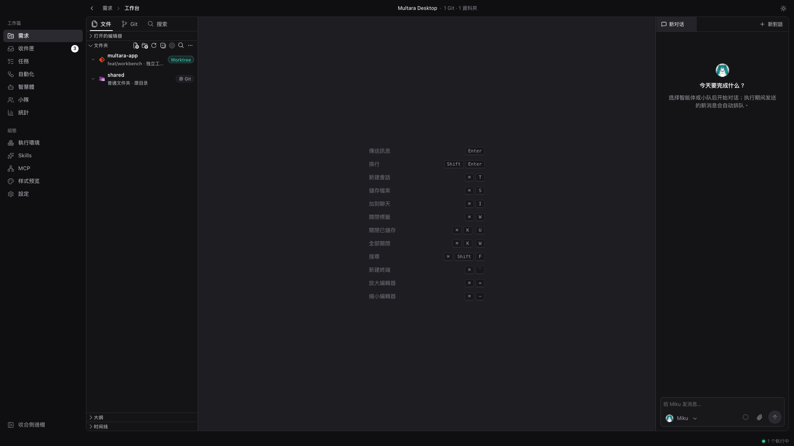
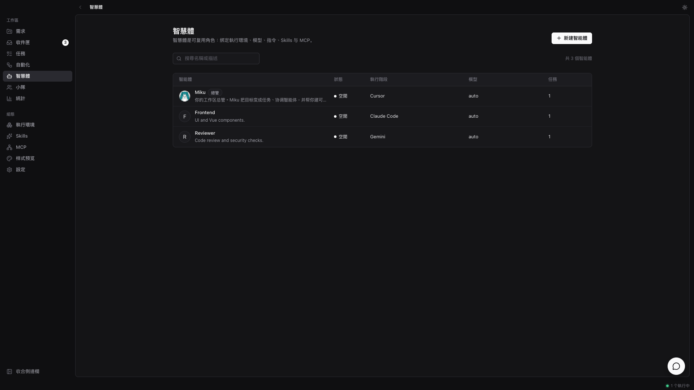
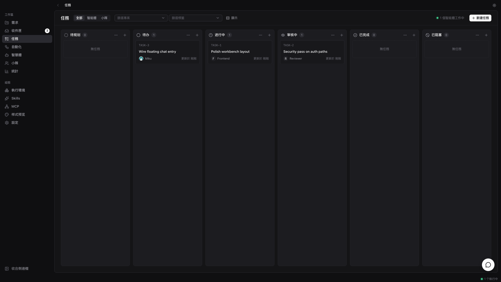
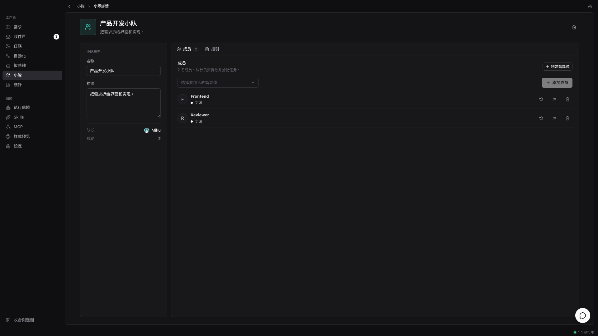
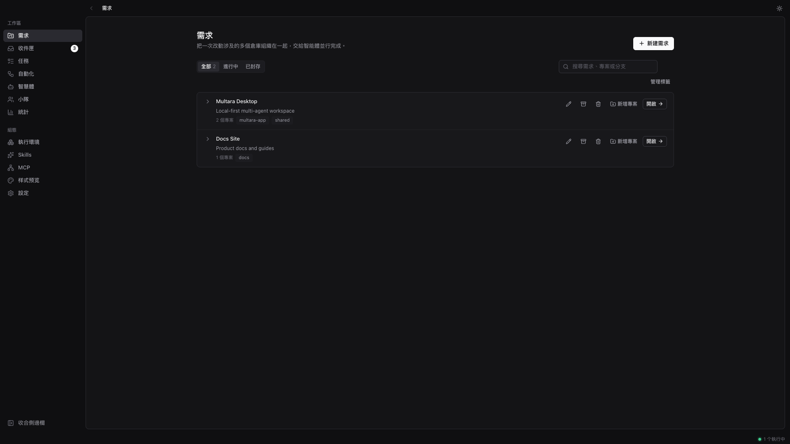
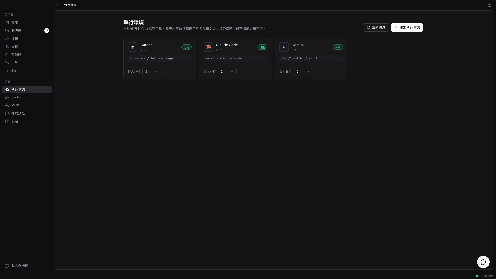
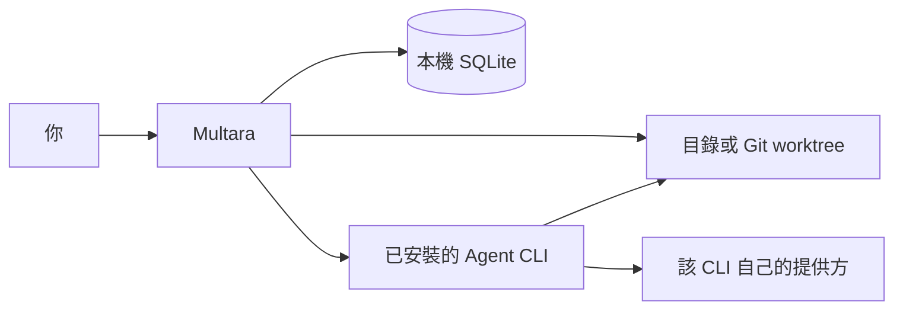

<div align="center">


# Multara

**本機優先的 AI 程式設計工作台**

一個工作區，容納每一個 AI 程式設計智慧體。

Multara 是給同時使用多個 AI 程式設計智慧體的開發者準備的桌面應用。Claude Code、OpenAI Codex、Cursor Agent，以及這台機器上的其他 CLI，共用同一個工作區：真實的專案目錄、任務、Monaco 編輯器、Git，以及智慧體的這次執行。

[](https://github.com/tomiaa12/Multara/releases/latest)
[](https://github.com/tomiaa12/Multara/stargazers)


**[English](README.md) · [简体中文](README-zh-CN.md) · 繁體中文 · [日本語](README-ja.md) · [한국어](README-ko.md)**

<p>
  <a href="https://github.com/tomiaa12/Multara/releases/download/v1.14.0/Multara_1.14.0_x64-setup.exe"></a>
  &nbsp;
  <a href="https://github.com/tomiaa12/Multara/releases/download/v1.14.0/Multara_1.14.0_aarch64.dmg"></a>
  &nbsp;
  <a href="https://github.com/tomiaa12/Multara/releases/latest"></a>
</p>

</div>

<p align="center">
  
</p>

<p align="center">
  <sub><em>需求工作台：本機檔案、Monaco 編輯器和智慧體聊天在同一個視窗。</em></sub>
</p>

---

## 主要能力

### 多個智慧體，一個工作區

每個智慧體有自己的名稱、執行環境、模型、說明，以及你掛上的 Skills 和 MCP。不同智慧體可以同時使用不同的 CLI。每個執行環境有自己的並行上限。

離開需求頁之後，聊天仍然以浮動面板留在視窗裡。

### 任務和小隊

任務放在看板上。可以派給一個智慧體，也可以派給一個小隊；派給小隊時，負責人是隊長。看板可以按智慧體或小隊篩選。

小隊有隊長和其他成員。Multara 先執行隊長，這一輪結束後再執行其他成員。

收件匣匯集需求、任務和浮動聊天裡的對話，也包括正等你處理的那些。

### 本機目錄、編輯器和 Git

一個需求掛上一組本機目錄。Git 倉庫可以在目前分支上直接改，也可以隔離成 Git worktree：新建分支，或遷出已有分支。普通資料夾按原目錄開啟。

工作台把檔案樹、搜尋、Monaco 編輯器、Git 面板、終端機和聊天放在同一個檢視裡。Git 面板可以查看狀態、暫存、提交、拉取和推送。

### 先看執行，再審程式碼

工具呼叫、命令和檔案改動會串流出現在聊天裡。規劃模式可以停下來，等你核准計畫。改過的檔案可以在 Monaco 裡開啟。編輯器裡還有未儲存的內容時，Multara 不會覆蓋它們。

統計匯總這些執行，包括執行記錄裡的 token 和費用數字。

### 還能接上什麼

- **Skills 和 MCP。** Multara 讀取這些 CLI 已經在用的 skill 目錄和 MCP 設定，再掛到智慧體上。
- **自動化。** 按時間或透過 webhook 執行一個智慧體或小隊。
- **Feishu 和 Lark。** 從這兩個渠道給智慧體或小隊發訊息，回覆保存在 Multara 裡。
- **外觀。** 淺色或深色主題。English、简体中文、繁體中文、日本語、한국어。語言跟隨系統，也可以在設定裡指定。
- **更新。** 應用從 GitHub Releases 在內部更新。

---

## 怎麼運作

1. 給需求加入本機目錄。Git 倉庫可以選擇 worktree，或直接使用目前目錄。
2. 建立一個智慧體，綁定 Multara 在 PATH 上找到的 CLI。
3. 把任務或一則聊天交給這個智慧體，或交給一個小隊。
4. Multara 在工作區目錄裡啟動 CLI。CLI 自己改磁碟上的檔案，並把進度串流送回來。
5. 在聊天裡看這次執行，用 Monaco 開啟檔案，準備提交時使用 Git 面板。

Multara 把自己的資料放在本機 SQLite 裡。它不附帶模型，也不負責安裝這些智慧體 CLI。

## 為什麼放在一個視窗裡

| | 分開的終端機 | Multara |
| --- | --- | --- |
| 檔案改在哪裡 | 啟動那個 CLI 時的目錄 | 你掛上的目錄或 Git worktree |
| 工作怎麼派 | 那個視窗裡的一段提示 | 指向智慧體或小隊的任務、聊天 |
| 之後看什麼 | 那個 CLI 的輸出記錄 | 串流執行、Monaco 和 Git 面板 |
| 用哪個 CLI | 一個視窗一個 | 本機已安裝並登入的受支援 CLI |

你繼續使用自己安裝的 CLI。Multara 是包在它們外面的工作區。

---

## 支援的 Agent CLI

Multara 在 PATH 上尋找這些命令。登入在 CLI 自己裡面完成。名單與 [`shared/cli-catalog.json`](shared/cli-catalog.json) 一致。

| 智慧體 | 命令 | 智慧體 | 命令 |
| --- | --- | --- | --- |
| Claude Code | `claude` | Codex | `codex` |
| Cursor | `cursor-agent` | GitHub Copilot | `copilot` |
| OpenCode | `opencode` | Gemini CLI | `gemini` |
| Qwen Code | `qwen` | Kimi CLI | `kimi` |
| Antigravity | `agy` | CodeArts | `codearts` |
| CodeBuddy | `codebuddy` | DevEco | `deveco` |
| Dim | `dim` | DSH | `dsh` |
| Grok | `grok` | Hermes | `hermes` |
| Kiro | `kiro-cli` | MiniMax Code | `mcode` |
| OMP | `omp` | OpenClaw | `openclaw` |
| Pi | `pi` | Qoder | `qodercli` |
| Qoder CN | `qoderclicn` | QwenPaw | `qwenpaw` |
| Reasonix | `reasonix` | TRAE CLI | `traecli` |
| ZeroClaw | `zeroclaw` | | |

Cursor 也會被辨識為 `agent`。GitHub Copilot 也會被辨識為 `github-copilot-cli`。**執行環境 → 添加執行環境**可以登記另一個本機命令。

Claude Code、Codex、OpenCode、Gemini CLI 和 Qwen Code 還可以使用你在執行環境上填寫的 API 位址。

---

## 安裝

下面的檔案來自 [Multara v1.14.0](https://github.com/tomiaa12/Multara/releases/tag/v1.14.0)。更新的建置在[發行版頁面](https://github.com/tomiaa12/Multara/releases/latest)。

| 平台 | 下載 |
| --- | --- |
| Windows x64 | [NSIS `.exe`](https://github.com/tomiaa12/Multara/releases/download/v1.14.0/Multara_1.14.0_x64-setup.exe) |
| macOS Apple Silicon | [`.dmg`](https://github.com/tomiaa12/Multara/releases/download/v1.14.0/Multara_1.14.0_aarch64.dmg) |

`.exe` 安裝包依目前使用者安裝。Windows 安裝過程在缺少 WebView2 時會下載它。macOS 需要 10.15 或更高版本。把 `Multara.app` 拖進「應用程式」。

已發布的 macOS 建置沒有公證。如果 Gatekeeper 提示應用程式已損毀，清掉隔離屬性：

```bash
xattr -cr /Applications/Multara.app
```

macOS Intel 和 Linux 的安裝包沒有發布。安裝之後，可以在應用內更新。

## 快速開始

1. 安裝 Multara，並安裝至少一個[受支援的 CLI](#支援的-agent-cli)。用該 CLI 自己的方式完成登入。
2. 打開**執行環境**，選擇**重新偵測**。找到的 CLI 會顯示**可用**、路徑和並行上限。
3. 建立智慧體，命名，並選中這個執行環境。首次啟動已經帶有一個名為 Miku 的智慧體。
4. 新建需求並加入本機目錄。Git 倉庫建議新建 worktree 分支，也可以把已有分支遷出為 worktree，或在目前目錄修改。
5. 為智慧體或小隊建立任務，或者打開需求並傳送聊天。
6. 看串流執行，再在編輯器和 Git 面板裡審閱檔案。

---

## 介面

<p align="center">
  
</p>

<p align="center">
  <sub><em>每個智慧體使用自己的執行環境。這裡是 Cursor、Claude Code 和 Gemini。</em></sub>
</p>

<p align="center">
  
  &nbsp;
  
</p>

<p align="center">
  <sub><em>任務在看板上指派。小隊寫明隊長和成員。</em></sub>
</p>

<p align="center">
  
  &nbsp;
  
</p>

<p align="center">
  <sub><em>需求把本機目錄分組。執行環境是這台機器上找到的 CLI。</em></sub>
</p>

同一套介面還有：[任務詳情](screenshots/zh-TW/1920/task-detail.png)、[收件匣](screenshots/zh-TW/1920/inbox.png)、[Skills](screenshots/zh-TW/1920/skills.png)、[MCP](screenshots/zh-TW/1920/mcp.png)、[自動化](screenshots/zh-TW/1920/automation.png)、[統計](screenshots/zh-TW/1920/stats.png)、[設定](screenshots/zh-TW/1920/settings.png)。

---

## 本機優先

Multara 是桌面應用。外殼是 Tauri 2，介面是 Vue 3，本機服務是 Rust。需求、智慧體、小隊、聊天、任務和執行佇列保存在應用資料目錄的 SQLite 檔案 `multara.sqlite3` 裡。



Multara 沒有自己的帳號。一次智慧體執行就是一個本機 CLI 行程，工作目錄是這個工作區。這個 CLI 仍使用它自己的登入，並把提示發給它自己的提供方。

## 支援的平台

| 平台 | 已發布的安裝包 |
| --- | --- |
| Windows x64 | `.exe` |
| macOS Apple Silicon | `.dmg`，macOS 10.15 或更高 |
| macOS Intel | 未發布 |
| Linux | 未發布 |

## 路線圖

沒有單獨的路線圖文件。進行中的工作記在 [issues](https://github.com/tomiaa12/Multara/issues)，已發布的建置列在 [GitHub Releases](https://github.com/tomiaa12/Multara/releases)。

## 參與貢獻

歡迎提 issue 和 pull request。

發布流程使用 Node.js 22、pnpm 10 和 stable Rust。

```bash
git clone https://github.com/tomiaa12/Multara.git
cd Multara
pnpm install
pnpm tauri:dev
```

`pnpm tauri:dev` 才是能讀取本機目錄並啟動 CLI 的應用。`pnpm dev` 只提供介面。`pnpm test` 執行前端單元測試。`pnpm build` 做前端型別檢查並產出網頁套件。

## 授權

這個儲存庫還沒有授權檔案。Copyright © 2026 Multara。
