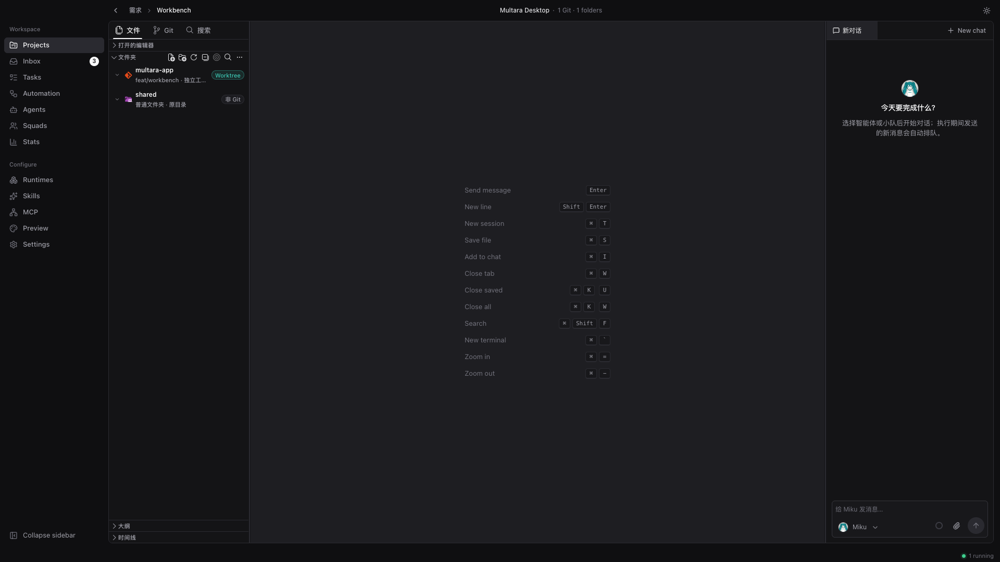
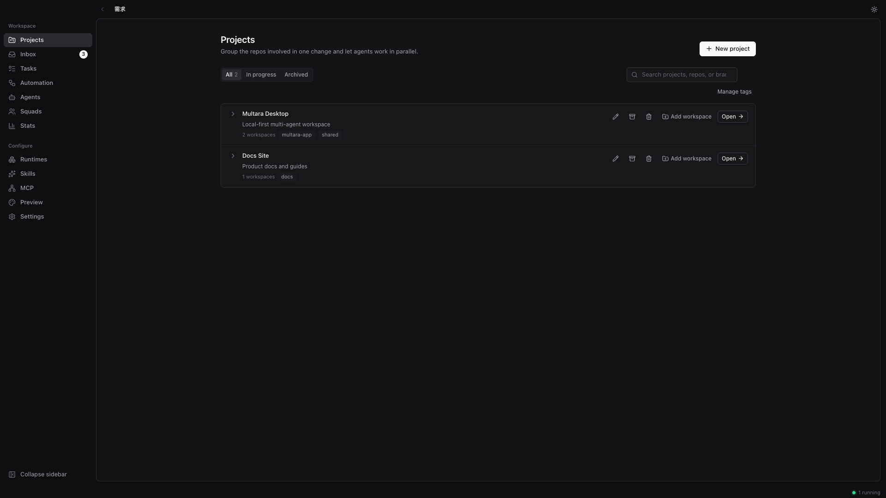
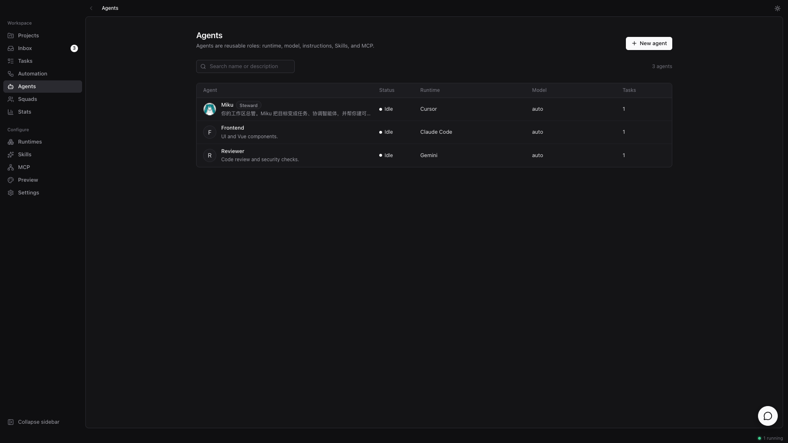
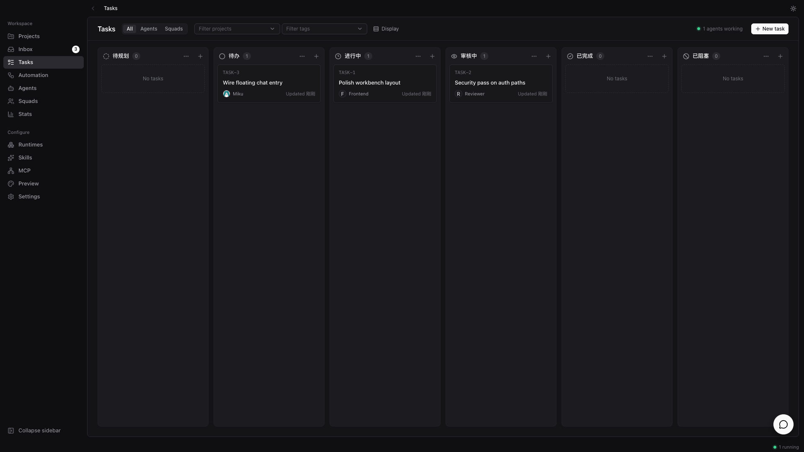
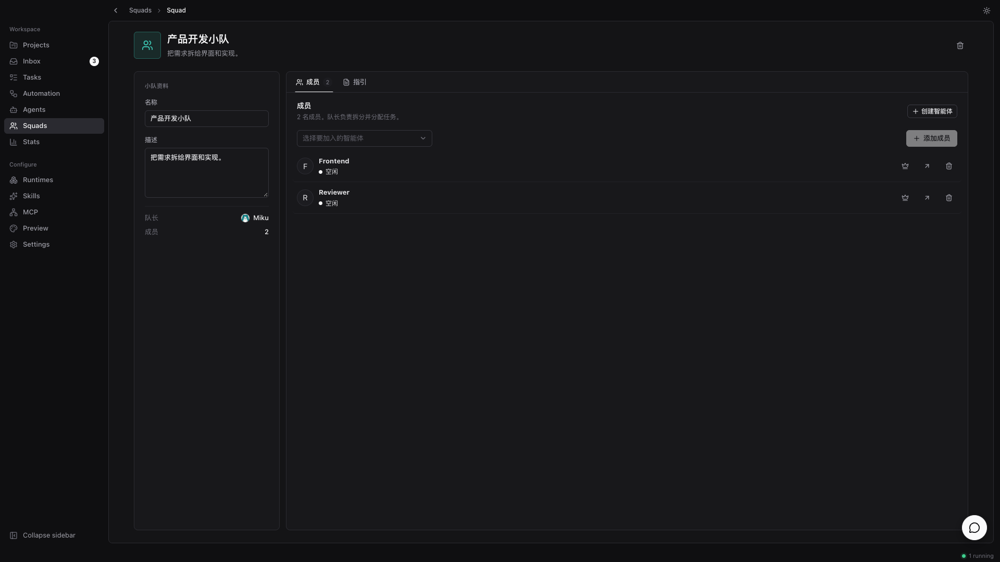

# Multara

**Agents that work on your machine.**

Multara is a local-first desktop workspace where you assign work to AI coding agents the way you'd
assign it to a teammate — they pick up the task, edit real folders, report progress, and hand it
back for review. Works with the agent CLIs you already use. No cloud account, no lock-in.

**English · [简体中文](README-zh-CN.md) · [繁體中文](README-zh-TW.md) · [日本語](README-ja.md) · [한국어](README-ko.md)**

  

  <em>One local workspace — projects, agents, and review in the same window.</em>

  
  &nbsp;
  

  
  &nbsp;
  

---

## What is Multara?

You already run Claude Code, Codex, and three other agents. Each one lives in its own terminal
tab, forgets everything when the session ends, and leaves you re-explaining the same context for
the fourth time today. The more agents you add, the more of your day goes to babysitting them.

Multara puts those agents in one local workspace. An agent gets assigned a task, picks it up on
its own, works in a folder you control, streams progress as it goes, and hands the result back for
review. The intent, the run, and the diff stay connected — so you don't reconstruct context, and
nothing lands without you looking at it.

---

## Build the team.

*Claude Code, Codex, Cursor, Kimi — you don't pick one. You hire them all.*

- **The agent CLIs you already use →** Claude Code, Codex, Cursor, Copilot, Kimi, OpenCode, Gemini, Qwen, and more.
- **Agents as teammates →** Give each one a name, a provider, and a runtime — they show up like anyone else.
- **Squads →** Put agents on one team; the leader routes the work.
- **Skills →** Turn a solved problem into a playbook every agent reuses.
- **MCP →** Wire the tools your agents need.
- **Your machine is the runtime →** Code never leaves your laptop. Multara detects the CLIs already installed.

## Hand off the work.

*It starts as a few sentences in chat or a task. It ends as reviewed edits on disk.*

- **Projects →** Group work and attach the folders agents need as context.
- **Workbench →** File tree, Monaco editor, Git status, and chat in one view.
- **Workspace isolation →** Open a folder directly, or isolate with `git worktree` / folder copy.
- **Tasks & automation →** Track work outside the chat stream; run recurring jobs.
- **Chat →** Ask from the workbench, or use floating chat without leaving the current page.
- **Assign an agent or squad →** Pick who owns the work the way you'd pick a colleague.

## Stay in the loop.

*Which agent touched this? What did it change? Open the run and the diff.*

- **Streaming execution →** Watch tool calls, commands, and edits as they happen.
- **Review in the editor →** Agent edits land on disk; you keep, revise, or discard in the workbench.
- **Git panel →** See status, stage, and commit from the same window.
- **Stats →** See how agents are used over time.
- **Inbox-style focus →** Jump back when something needs your call, not for every step.

## Make it yours.

*Your machine, your folders, your rules — local-first by default.*

- **Local-first →** Projects, agents, squads, chats, and the run queue live in SQLite on your machine.
- **Light / dark theme**
- **English · 简体中文 · 繁體中文 · 日本語 · 한국어** — follows the system language, or pick one in Settings
- **In-app updates** from GitHub Releases

---

## Get started

1. Download **[Multara](https://github.com/tomiaa12/Multara/releases/latest)** for Windows or macOS.
2. Install at least one [supported agent CLI](#runtimes) and sign in — Multara drives them; it doesn't ship them.
3. Open Multara, add a project with a local folder, create an agent, and assign it something.

| Platform | Installer |
| --- | --- |
| Windows | `.exe` or `.msi` |
| macOS (Apple Silicon) | `.dmg` |
| macOS (Intel) | `.dmg` |

On macOS, drag `Multara.app` into Applications.

---

## Runtimes

Multara does not ship a model. It drives the agent CLIs you already have installed and
authenticated — so switching providers is a dropdown, not a migration.

| Provider | CLI | Provider | CLI |
| --- | --- | --- | --- |
| Claude Code | `claude` | OpenAI Codex | `codex` |
| Cursor Agent | `cursor-agent` | GitHub Copilot CLI | `copilot` |
| OpenCode | `opencode` | Gemini | `gemini` |
| Qwen Code | `qwen` | Kimi | `kimi` |
| Grok | `grok` | CodeBuddy | `codebuddy` |
| OpenClaw | `openclaw` | Hermes | `hermes` |
| Pi | `pi` | Antigravity | `agy` |
| Kiro CLI | `kiro-cli` | Qoder CLI | `qodercli` |
| Trae CLI | `traecli` | MiniMax Code | `mcode` |
| …and more | | | |

---

## Inspiration

Multara is inspired by [Multica](https://github.com/multica-ai/multica) — agents on the board,
work handed off like teammates. Multara takes that idea into a local-first desktop workspace.
