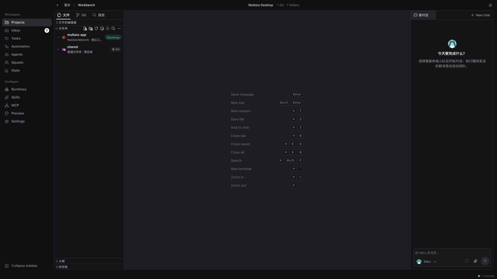
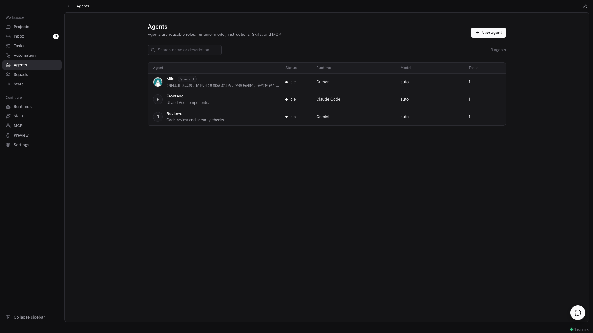
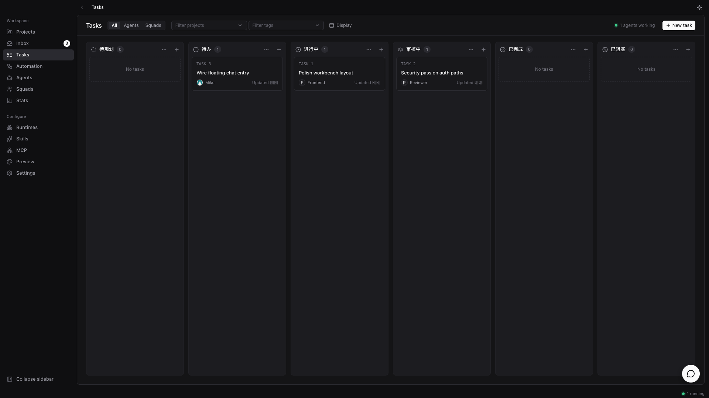
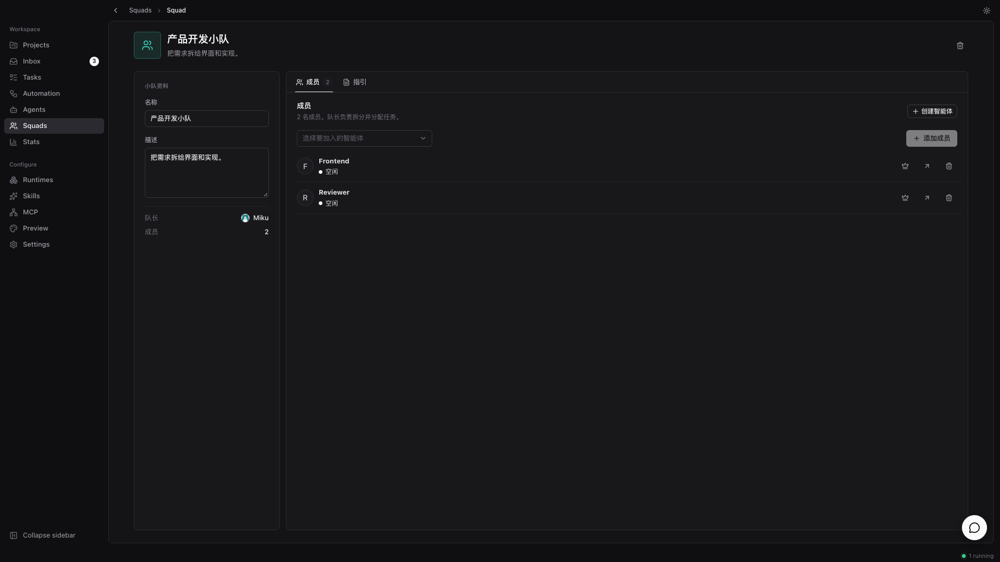
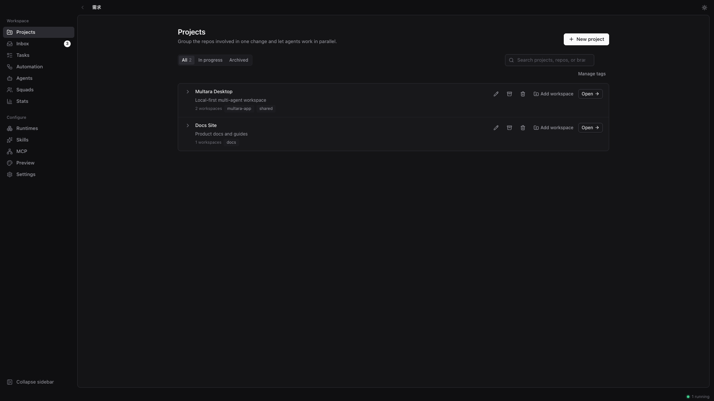
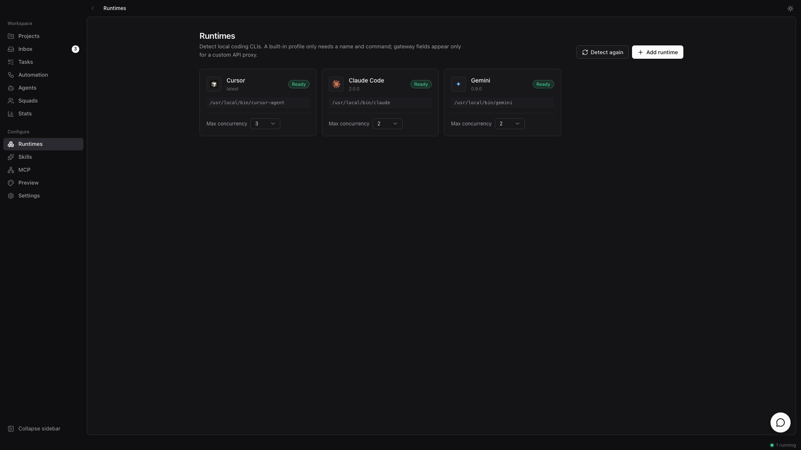
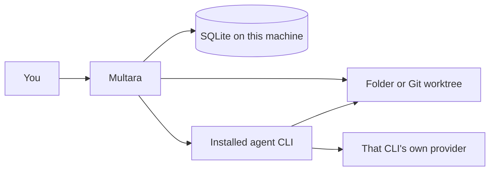

<div align="center">


# Multara

**A local-first AI coding workbench**

One workspace for every AI coding agent.

Multara is a desktop application for developers who already use more than one AI coding agent. Claude Code, OpenAI Codex, Cursor Agent, and the other CLIs on your machine share one workspace: real project folders, tasks, a Monaco editor, Git, and the agent run.

[](https://github.com/tomiaa12/Multara/releases/latest)
[](https://github.com/tomiaa12/Multara/stargazers)


**English · [简体中文](README-zh-CN.md) · [繁體中文](README-zh-TW.md) · [日本語](README-ja.md) · [한국어](README-ko.md)**

<p>
  <a href="https://github.com/tomiaa12/Multara/releases/download/v1.14.0/Multara_1.14.0_x64-setup.exe"></a>
  &nbsp;
  <a href="https://github.com/tomiaa12/Multara/releases/download/v1.14.0/Multara_1.14.0_aarch64.dmg"></a>
  &nbsp;
  <a href="https://github.com/tomiaa12/Multara/releases/latest"></a>
</p>

</div>

<p align="center">
  
</p>

<p align="center">
  <sub><em>The project workbench: local files, the Monaco editor, and the agent chat in one window.</em></sub>
</p>

---

## Key features

### Many agents, one workspace

Each agent has a name, a runtime, a model, instructions, and the Skills and MCP servers you attach. Different agents can use different CLIs at the same time. Each runtime has its own concurrency limit.

Outside a project, chat stays available as a floating panel.

### Tasks and squads

Tasks sit on a board. Create one for an agent, or for a squad — a squad task is assigned to that squad's leader. The board can be filtered by agent or by squad.

A squad has a leader and other members. Multara starts the leader first. When that run finishes, it starts the other members.

The inbox gathers conversations from projects, tasks, and the floating chat, including ones that are waiting on you.

### Local folders, editor, and Git

A project groups the folders for one piece of work. A Git repository can be opened on its current branch, or isolated in a Git worktree: a new branch, or an existing one. A plain folder is opened in place.

The workbench puts the file tree, search, Monaco editor, Git panel, terminal, and chat in one view. The Git panel can show status, stage, commit, pull, and push.

### See the run, then review the code

Tool calls, commands, and edits stream into the chat. Plan mode can wait until you approve the plan. Changed files can be opened in Monaco. If the editor has unsaved changes, Multara leaves them in place.

Stats summarize runs, including the token and cost numbers those runs report.

### What you can attach

- **Skills and MCP.** Multara reads the skill folders and MCP configs those CLIs already use, and you attach them to an agent.
- **Automation.** Run an agent or a squad on a schedule or from a webhook.
- **Feishu and Lark.** Message an agent or a squad from either channel. Replies are stored in Multara.
- **Appearance.** Light or dark theme. English, 简体中文, 繁體中文, 日本語, and 한국어. The language follows the system, or you pick one in Settings.
- **Updates.** The app updates itself from GitHub Releases.

---

## How it works

1. Add a local folder to a project. For a Git repository, choose a worktree or the current directory.
2. Create an agent and bind it to a CLI Multara found on your PATH.
3. Assign a task, or send a chat, to that agent or to a squad.
4. Multara starts the CLI in the workspace directory. The CLI edits files on disk and streams progress back.
5. Read the run in chat, open the files in Monaco, and use the Git panel when you are ready to commit.

Multara stores its own data in a local SQLite database. It does not ship a model, and it does not install the agent CLIs.

## Why one window

| | Separate terminals | Multara |
| --- | --- | --- |
| Where files are edited | The directory that CLI was started in | The folder or Git worktree you attached |
| How work is assigned | The prompt in that window | A task or chat aimed at an agent or a squad |
| What you review | That CLI's transcript | The streamed run, Monaco, and the Git panel |
| Which CLI | One per window | Any supported CLI that is installed and signed in |

You keep using the CLIs you already installed. Multara is the workspace around them.

---

## Supported agent CLIs

Multara looks these commands up on your PATH. Sign in with the CLI itself. The list matches [`shared/cli-catalog.json`](shared/cli-catalog.json).

| Agent | Command | Agent | Command |
| --- | --- | --- | --- |
| Claude Code | `claude` | Codex | `codex` |
| Cursor | `cursor-agent` | GitHub Copilot | `copilot` |
| OpenCode | `opencode` | Gemini CLI | `gemini` |
| Qwen Code | `qwen` | Kimi CLI | `kimi` |
| Antigravity | `agy` | CodeArts | `codearts` |
| CodeBuddy | `codebuddy` | DevEco | `deveco` |
| Dim | `dim` | DSH | `dsh` |
| Grok | `grok` | Hermes | `hermes` |
| Kiro | `kiro-cli` | MiniMax Code | `mcode` |
| OMP | `omp` | OpenClaw | `openclaw` |
| Pi | `pi` | Qoder | `qodercli` |
| Qoder CN | `qoderclicn` | QwenPaw | `qwenpaw` |
| Reasonix | `reasonix` | TRAE CLI | `traecli` |
| ZeroClaw | `zeroclaw` | | |

Cursor is also detected as `agent`. GitHub Copilot is also detected as `github-copilot-cli`. **Runtimes → Add runtime** can register another local command.

Claude Code, Codex, OpenCode, Gemini CLI, and Qwen Code can also use an API base URL you set on the runtime.

---

## Installation

These buttons download [Multara v1.14.0](https://github.com/tomiaa12/Multara/releases/tag/v1.14.0). Newer builds are on the [releases page](https://github.com/tomiaa12/Multara/releases/latest).

| Platform | Download |
| --- | --- |
| Windows x64 | [NSIS `.exe`](https://github.com/tomiaa12/Multara/releases/download/v1.14.0/Multara_1.14.0_x64-setup.exe) |
| macOS Apple Silicon | [`.dmg`](https://github.com/tomiaa12/Multara/releases/download/v1.14.0/Multara_1.14.0_aarch64.dmg) |

The `.exe` installer is per-user. Windows setup downloads the WebView2 runtime when it is missing. On macOS, the app requires macOS 10.15 or later. Drag `Multara.app` into Applications.

The published macOS build is not notarized. If Gatekeeper says the app is damaged, clear the quarantine flag:

```bash
xattr -cr /Applications/Multara.app
```

macOS Intel and Linux installers are not published. After installation, updates can be installed from inside the app.

## Quick start

1. Install Multara, and install at least one [supported CLI](#supported-agent-clis). Complete that CLI's own login.
2. Open **Runtimes** and choose **Detect again**. A found CLI shows **Ready**, with its path and a concurrency limit.
3. Create an agent, name it, and select that runtime. The first launch already includes an agent named Miku.
4. Create a project and add a local folder. For Git, the recommended choice is a new worktree branch. You can also check out an existing branch as a worktree, or edit the current directory.
5. Create a task for the agent or a squad, or open the project and send a chat.
6. Watch the streamed run, then review the files in the editor and the Git panel.

---

## Screenshots

<p align="center">
  
</p>

<p align="center">
  <sub><em>Each agent keeps its own runtime. This workspace has Cursor, Claude Code, and Gemini.</em></sub>
</p>

<p align="center">
  
  &nbsp;
  
</p>

<p align="center">
  <sub><em>Tasks are assigned on the board. A squad names a leader and its members.</em></sub>
</p>

<p align="center">
  
  &nbsp;
  
</p>

<p align="center">
  <sub><em>Projects group local folders. Runtimes are the CLIs found on this machine.</em></sub>
</p>

More of the interface, in the same style: [task detail](screenshots/en/1920/task-detail.png), [inbox](screenshots/en/1920/inbox.png), [skills](screenshots/en/1920/skills.png), [MCP](screenshots/en/1920/mcp.png), [automation](screenshots/en/1920/automation.png), [stats](screenshots/en/1920/stats.png), [settings](screenshots/en/1920/settings.png).

---

## Local-first

Multara is a desktop app. The shell is Tauri 2, the interface is Vue 3, and the local services are Rust. Projects, agents, squads, chats, tasks, and the run queue are stored in SQLite at `multara.sqlite3` in the app data directory.



There is no Multara account. An agent run is a local CLI process with its working directory set to the workspace. That CLI still uses its own login, and it sends the prompt to its own provider.

## Supported platforms

| Platform | Published installer |
| --- | --- |
| Windows x64 | `.exe` |
| macOS Apple Silicon | `.dmg`, macOS 10.15 or later |
| macOS Intel | Not published |
| Linux | Not published |

## Roadmap

There is no separate roadmap document. Work in progress is tracked in [issues](https://github.com/tomiaa12/Multara/issues), and shipped builds are listed on [GitHub Releases](https://github.com/tomiaa12/Multara/releases).

## Contributing

Issues and pull requests are welcome.

The release workflow uses Node.js 22, pnpm 10, and stable Rust.

```bash
git clone https://github.com/tomiaa12/Multara.git
cd Multara
pnpm install
pnpm tauri:dev
```

`pnpm tauri:dev` is the app that can read local folders and start CLIs. `pnpm dev` only serves the interface. `pnpm test` runs the frontend unit tests. `pnpm build` typechecks the frontend and produces the web bundle.

## License

This repository does not include a license file. Copyright © 2026 Multara.
